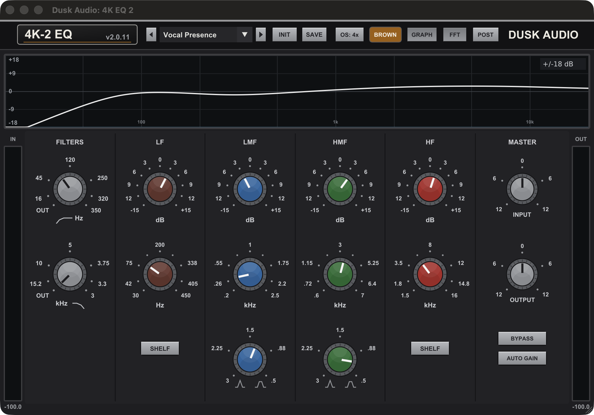

# 4K EQ 2

## Overview

4K EQ 2 models the equalizer and high-pass/low-pass filters of a classic
British E-series channel strip. The Brown and Black modes are separate
voicings, not cosmetic themes. Each mode uses its own measured frequency,
gain, Q, shelf, filter, interaction, nonlinearity, and overload behavior.

Use it for broad tonal decisions where a console EQ is faster than a surgical
parametric equalizer: shaping drums, moving a vocal forward, removing low-end
clutter, or adding a restrained shelf to a mix bus. The LMF and HMF sections
remain fully adjustable when a narrower correction is needed, but this is not
a dynamic EQ or a linear-phase mastering tool.

The modeled EQ path has a fixed amount of native nonlinear color. There is no
Drive control. Raise Input when you want to hit the modeled path harder, then
trim Output for a fair comparison. The preamp and dynamics portions of the
original channel strip are intentionally outside this plugin.

## Quick Start

1. Insert 4K EQ 2 and click **INIT**. Leave Input and Output at 0 dB, Auto Gain
   off, and the filters at OUT while you learn the bands.
2. Start in **Brown** mode. Raise one gain control to about +6 dB, sweep its
   frequency until the target becomes obvious, then reduce the gain to the
   amount the mix needs.
3. Use **LMF Q** or **HMF Q** to set bandwidth. Lower values make a wider move;
   higher values focus the boost or cut.
4. Use the LF or HF button to switch that band between **SHELF** and **BELL**.
5. Turn the HPF away from OUT to remove low-frequency buildup. Turn the LPF
   away from OUT only when the source needs deliberate top-end restriction.
6. Switch to **Black** and compare at the same settings. In both modes the LMF
   and HMF bells get narrower at the top as you add boost or cut, and a cut is
   the mirror image of the same boost. Black applies more boost or cut than
   Brown at the same knob setting, which is why it can sound tighter and
   stronger.
7. If you raise Input for more nonlinear character, lower Output by roughly the
   same amount. Enable Auto Gain only as a convenience while auditioning.

The frequency knobs carry the console's printed dial markings, and a knob set
to a marking plays what the modeled console plays at that marking in the
selected mode. A marking is a position on the dial, not the exact frequency of
the band, and the same marking can put a band at a different frequency in
Brown and Black. At its 1 mark the LMF centres the band near 800 Hz in Brown
and near 590 Hz in Black, the Brown HMF goes no higher than about 6.4 kHz from
its 6.4 mark up, and a Brown HPF at its 120 mark is 3 dB down near 80 Hz. The
response graph shows where each band sits.

The value bubble shows a frequency knob's dial setting: 30.0 Hz, 200 Hz,
1.00 k or 16.0 k, the LPF in whole hertz (15201 Hz), and Out for an HPF or LPF
knob at OUT. Turning a gain knob or switching between Brown and Black does not
change it. Double-click a knob to type a setting in the same form or as a
number of hertz; typing Out in the HPF or LPF field switches that filter out.

## Workflows

The frequencies in these workflows, and in the preset descriptions further
down, are where each band plays, as the response graph shows it, not the
markings its knob points at. The factory presets play them except where a dial
runs out: an HF shelf goes no higher than about 5.5 to 6 kHz in Brown and 7 to
7.5 kHz in Black, the Black LF shelf no lower than about 80 Hz, the Brown HMF
no higher than about 6.4 kHz, and the LPF no lower than about 3.2 kHz. A
preset that lists a frequency beyond those plays the end of that dial.

### Vocal presence without losing body

**Source:** Lead vocal peaking around -10 dBFS with low-frequency proximity
build-up. **Target:** Reduce rumble and boxiness while moving consonants forward.

- Brown mode
- HPF at 80 Hz
- LF +3 dB at 100 Hz, shelf
- LMF -3 dB at 300 Hz, Q 1.3
- HMF +4 dB at 3.5 kHz, Q 0.7
- HF +2 dB at 8 kHz, shelf
- Input and Output at 0 dB; Auto Gain off

This is the **Vocal Presence** factory preset. The HPF clears material below the
useful vocal range, the LMF cut reduces boxiness, and the wide HMF/HF boosts add
intelligibility and air. If the result is sharp, lower the HMF gain first rather
than moving every frequency.

### Kick with weight and beater definition

**Source:** Close kick microphone with useful sub energy but too much 200 Hz
body. **Target:** Add low-end weight and a readable attack in a dense mix.

- Brown mode
- HPF at 30 Hz
- LF +4 dB at 50 Hz, shelf
- LMF -2.5 dB at 200 Hz, Q 0.8
- HMF +3 dB at 2 kHz, Q 1.5
- HF flat
- Input +2 dB and Output -2 dB if additional path color is wanted

The broad LF move supplies weight, the LMF cut makes room above it, and the
narrower HMF boost adds beater definition. Start from **Kick Punch** and move
the LF frequency toward 70 or 80 Hz when the drum's fundamental sits higher.

### Black-mode drum bus shaping

**Source:** Stereo drum bus with enough level but soft low-end impact and a
cloudy low-mid range. **Target:** Tighter punch with a modest top lift.

- Black mode
- Filters at OUT
- LF +4 dB at 70 Hz, shelf
- LMF -3 dB at 350 Hz, Q 0.6
- HMF +3 dB at 3.5 kHz, Q 1.0
- HF +2.5 dB at 10 kHz, shelf
- Input 0 dB; Output 0 dB; Auto Gain off

This is **Drum Bus Punch**, the factory bank's Black-mode preset. Black's mid
bands boost and cut more than Brown's at the same settings and are a little
narrower at the top, which keeps the moves tight. If cymbals become forward,
reduce the HF gain before changing the HMF presence move.

### Acoustic guitar cleanup and detail

**Source:** Close-miked steel-string guitar with low-body buildup and muted
pick detail. **Target:** Clear space below the instrument and recover articulation.

- Brown mode
- HPF at 80 Hz
- LF -2 dB at 100 Hz, shelf
- LMF +2 dB at 200 Hz, Q 0.7
- HMF +3 dB at 2.5 kHz, Q 0.9
- HF +4 dB at 12 kHz, shelf

Load **Acoustic Guitar** as the starting point. If the guitar is already thin,
return LF to 0 dB before reducing the HPF. If finger noise dominates, lower the
HMF move while keeping the HF shelf for openness.

### Restrained mix-bus sweetening

**Source:** Balanced mix with headroom and no major corrective problem.
**Target:** Small tonal moves that remain useful after level matching.

- Brown mode
- Filters at OUT
- LF +1 dB at 50 Hz, shelf
- LMF -1 dB at 600 Hz, Q 0.5
- HMF +0.5 dB at 4 kHz, Q 0.6
- HF +1.5 dB at 15 kHz, shelf
- Output -0.5 dB
- Input 0 dB; Auto Gain off

This is **Master Bus Sweetening**. Compare with Bypass at the same perceived
level. On a finished mix, a 0.5 dB change is meaningful; avoid compensating for
an unsuitable curve by driving the modeled path harder.

## Parameter Reference

### Header and presets

- **Preset browser:** Recalls 14 factory programs and saved user presets.
  Factory recall owns the sound-shaping parameters but leaves oversampling and
  analyzer preferences alone. A common mistake is expecting a recalled preset
  to restore the previous oversampling choice.
- **INIT:** Restores all preset-owned parameters to their defaults. It does not
  alter Bypass, oversampling, or analyzer state. Use it for a flat starting
  point.
- **SAVE:** Writes the current sound-shaping state to the user preset library.
  On macOS and Linux, presets live under
  `~/.config/DuskAudio/FourKEQ2/presets`; Windows uses the application-data
  directory. Invalid or unsupported preset files are ignored by the browser.
- **OS:** Cycles 1x, 2x, and 4x; default 4x. Higher factors reduce aliasing from
  the nonlinear path but use more CPU and add latency. At 88.2 or 96 kHz the
  effective maximum is 2x; at 176.4 or 192 kHz it is 1x.
- **BROWN / BLACK:** Selects the complete console voicing; default Brown. Black
  applies more boost or cut than Brown at the same knob setting, its LMF and
  HMF bells are a little narrower at the top, and a frequency marking can put
  a band at a different frequency in each mode.
- **GRAPH:** Shows or collapses the response graph. The graph range menu offers
  +/-6, +/-12, +/-18, +/-30 dB, and a warped view.
- **FFT:** Enables or disables the live spectrum trace. Disable it when you want
  the lowest possible UI overhead.
- **PRE / POST:** Selects the analyzer tap before or after the EQ. It changes
  only the display, not the audio path.

### Filters

- **HPF:** OUT by default, then 16 to 350 Hz. Moving away from OUT enables the
  filter. Brown and Black use different measured responses. Use it to remove
  rumble; the common mistake is setting it from the printed dial alone without
  listening to the source's fundamental.
- **LPF:** OUT by default, then 15.201 down to 3 kHz. Use it for deliberate
  bandwidth restriction or high-frequency cleanup. The control runs downward
  in frequency as it turns clockwise, matching the panel layout.

On both filter knobs the stretch between OUT and the first marking plays that
marking, so a filter there stays where it is as you turn toward OUT, until the
knob reaches OUT and switches it out. A knob at the end of its travel does not
move when you turn it further that way.

### EQ bands

- **LF Gain:** -15 to +15 dB, default 0 dB. **LF Frequency:** 30 to 450 Hz,
  default 200 Hz. **SHELF/BELL:** shelf by default. Use the shelf for broad
  weight and the bell for a localized low-frequency move.
- **LMF Gain:** -15 to +15 dB, default 0 dB. **LMF Frequency:** 200 Hz to
  2.5 kHz, default 1 kHz. **LMF Q:** 0.5 to 3.0, default 1.5. Use lower Q for
  broad body changes and higher Q for a focused low-mid correction.
- **HMF Gain:** -15 to +15 dB, default 0 dB. **HMF Frequency:** 600 Hz to 7 kHz,
  default 3 kHz. **HMF Q:** 0.5 to 3.0, default 1.5. Use it for presence,
  attack, or upper-mid harshness.
- **HF Gain:** -15 to +15 dB, default 0 dB. **HF Frequency:** 1.5 to 16 kHz,
  default 8 kHz. **SHELF/BELL:** shelf by default. Use the shelf for air and
  the bell when the desired change is centered below the extreme top end.

At exactly 0 dB, each EQ section bypasses its recursive filter state. This
keeps the neutral path free of the subsonic numerical residue that can result
from running nominally unity biquads.

### Master and metering

- **Input:** -12 to +12 dB, default 0 dB. It sets the level entering the modeled
  EQ path and therefore the nonlinear behavior. Do not treat it as an output
  loudness control.
- **Output:** -12 to +12 dB, default 0 dB. Use it to restore level after Input
  changes or deliberate EQ boosts.
- **Bypass:** Off by default. It uses a short smoothing transition to avoid a
  click. Compare at matched level.
- **Auto Gain:** Off by default. It estimates compensation from the active EQ
  curve. It is useful while exploring, but a spectrum-based estimate cannot
  guarantee equal perceived loudness for every source.
- **IN / OUT meters:** Peak meters at the panel edges. The numeric hold refreshes
  more slowly than the bars so short peaks remain readable.

## Tips and Traps

- Brown and Black can put a band at different frequencies for the same knob
  setting, as the console does. Use the response graph when matching a known
  frequency.
- Frequency automation and the frequency values a host shows are dial
  settings, the numbers the knobs show, as plain numbers of hertz: the LMF
  knob's 1.00 k reads 1000 in a host's parameter list.
- A large EQ boost can hit the modeled rail even when the DAW input meter looks
  safe. Lower Input or the band gain if the overload is not intentional.
- Auto Gain is a convenience, not part of the modeled channel-strip signal
  path. Factory presets turn it off so their level and curve recall deterministically.
- Oversampling changes reported latency. Avoid changing it while recording or
  while a host is not prepared to refresh plugin delay compensation.
- The old Drive and M/S parameter indices may still appear in generic host
  views for compatibility. They are hidden or inert and are not part of the UI.

## Presets Explained

- **Vocal Presence:** Brown vocal cleanup and forward presence. Adjust the HPF
  first for the singer, then the 3.5 kHz HMF gain.
- **Kick Punch:** Low shelf, low-mid cut, and 2 kHz attack. Move LF frequency to
  the drum's fundamental.
- **Snare Crack:** 250 Hz body, 5 kHz crack, and an 8 kHz HF bell. Lower HMF if
  the snare becomes brittle.
- **Drum Bus Punch:** The single Black factory preset, with tighter low-mid and
  presence shaping. Reduce HF first on cymbal-heavy buses.
- **Bass Warmth:** 80 Hz weight with a 400 Hz cut and 10 kHz LPF. Move the LPF
  out for bright bass parts.
- **Bass Guitar Polish:** 60 Hz weight, 250 Hz cleanup, and upper-mid definition.
  Adjust HMF for finger or pick noise.
- **Acoustic Guitar:** HPF cleanup plus 2.5 kHz detail and a 12 kHz shelf. Return
  LF to flat on thin recordings.
- **Piano Brilliance:** Low foundation, 500 Hz cleanup, and two presence lifts.
  Reduce HF on close, bright piano recordings.
- **Bright Mix:** 60 Hz and 10 kHz shelves around a 2.5 kHz dip. Keep each move
  small on a finished mix.
- **Glue Bus:** A broader mix-bus contour centered on 100 Hz, 3 kHz, and 10 kHz.
  Use Output for level matching.
- **Telephone EQ:** 300 Hz HPF, 3 kHz LPF, and 1 kHz LMF boost. Adjust the LMF
  gain to control how nasal the result becomes.
- **Air & Silk:** HMF at 7 kHz plus a 15 kHz shelf. Lower HMF before HF when
  sibilance rises.
- **Master Sheen:** Small 5 kHz and 16 kHz lifts. Start here when the mix needs
  only top-end polish.
- **Master Bus Sweetening:** Four sub-1.5 dB mastering moves with -0.5 dB output.
  Bypass frequently and keep the change only if it survives level matching.

## Troubleshooting

**The EQ appears to do nothing.** Confirm Bypass is off and at least one band
gain is away from 0 dB, or an HPF/LPF knob is not OUT. The HPF and LPF remain
bypassed only while their knobs read OUT.

**The response graph does not peak at the number on the knob.** The knob and
its bubble show the console's dial marking, which is not the frequency of the
band, and Brown and Black can place the same marking differently. The graph
shows where the band plays; use it when an exact frequency matters.

**The plugin becomes louder or distorts after an Input change.** Lower Output
by the same amount for comparison. If it still overloads, lower Input or the
largest EQ boost. Auto Gain compensates the curve estimate, not every nonlinear
level change.

**A saved preset is missing from the browser.** Check that the preset directory
is writable. Files with malformed numeric fields, unsupported format versions,
or unsupported frequency domains are rejected rather than partially loaded.
