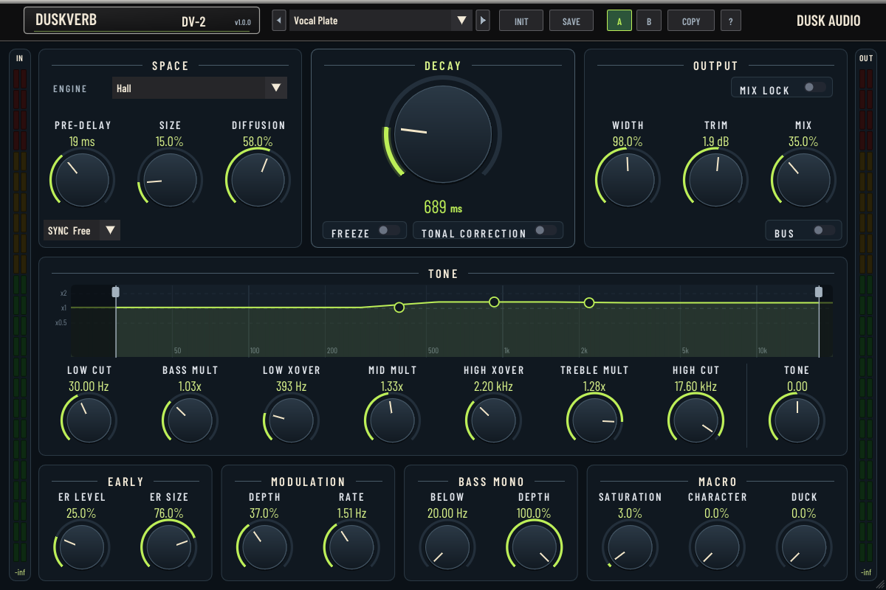

# DuskVerb 2

## Overview

DuskVerb 2 combines the original DuskVerb reverb engines with a redesigned
interface. The factory presets provide starting points for plates, rooms,
halls, springs and other spaces. Engine selection changes the reverb topology;
some controls change labels or availability to match the selected engine.

The panel reads left to right in signal order: Pre-delay sits beside the input
meter, Mix beside the output meter, and the large Decay knob in the middle.

## Quick Start

1. Select a factory preset from the top preset menu. The arrows move through presets.
2. Adjust **Decay** and **Size** to fit the source and arrangement.
3. Set **Mix** for an insert, or enable **Bus** for a fully wet return. Turn on
   **Mix Lock** to keep Mix and Bus where they are while you audition presets.
4. Use **Pre-delay** to separate the source from the reverb. Choose a rhythmic
   division in **Sync** to follow the host tempo.
5. Shape the tail in the **Tone** row: drag the handles on the graph or turn the
   knobs below it. Then adjust **Trim**.
6. Click **Save** to store your sound as a user preset.

## Controls

| Section | Purpose |
|---|---|
| Space | The engine, Pre-delay with tempo sync, Size and Diffusion. While sync is active the Pre-delay knob shows the division and keeps its free value. |
| Decay | The decay time, the time the tail takes to fall by 60 dB at mid frequencies, and **Freeze**, which holds the reverb. On the Gated engine Decay sets the gate length, on Reverse the swell and on Nonlinear the burst length. Beside Freeze sits the selected engine's own tail switch where it has one: **Gate** on the Gated engine, **Tonal Correction** on the engines whose tail it evens out. |
| Output | Width, Trim and Mix. **Bus** overrides Mix with a fully wet output while retaining its setting. **Mix Lock** keeps Mix and Bus when a preset, INIT or an import is recalled, or when the host changes program; A/B comparison is unaffected. |
| Tone | The graph shows how long each part of the spectrum rings relative to Decay (the Bass, Mid and Treble multipliers with their crossovers) and shades what Low Cut and High Cut remove from the wet signal. The knobs below it follow in frequency order. Tone tilts the whole wet signal darker or brighter. |
| Early | Early-reflection level and size. |
| Engine card | The selected engine's own controls: modulation depth and rate on most engines, or the Spring, Shimmer and Gate controls on those engines. |
| Bass Mono | Sums the wet signal to mono below a frequency, with a depth control. |
| Macro | Saturation, Character and Duck. |

Controls the selected engine does not use are dimmed; they keep their value for
an engine that does. **Gate** and **Tonal Correction** appear only on the engines
they affect.

The side meters show input and output levels. The Tone graph shows the settings,
not a measurement of the acoustic decay. On most factory presets Decay reads the
decay time measured on the preset itself, averaged over 500 Hz and 1 kHz.

## Editing Values

- Drag a knob to adjust it; hold Shift for finer movement.
- Use the mouse wheel to step a value.
- Click a numeric readout or double-click a knob to type a value. Enter applies
  it; Escape cancels. Invalid input stays available for correction.
- Right-click a knob for its reset and value-entry menu.
- Ctrl-click or Alt-click resets a knob on Windows/Linux. On macOS, use
  Alt-click or Cmd-click.
- Drag a handle on the Tone graph to move its band's crossover and decay
  together. Hold Shift to move only the frequency, or Ctrl (Cmd on macOS) to
  move only the level. Alt-click a handle to reset it.
- Drag the editor corner to resize. The minimum size is 1050 × 700.
- Click **?** for the in-plugin control reference and this instance's CPU load.

## Presets and Comparison

**INIT** restores defaults. Factory recall applies the factory sound while
preserving the settings intentionally excluded by the original preset format.
An asterisk beside the preset name indicates an edited sound.

**A** and **B** switch between complete comparison snapshots. **COPY** copies
the active sound into the other slot without switching. Save sounds you want
to keep as user presets; comparison slots are a working audition tool.

The Save dialog requires explicit replacement confirmation for an existing
name. Names that map to the same filename, such as `Alpha/Beta` and
`Alpha-Beta`, receive distinct filenames. Right-click a user preset to delete
it. The preset menu also offers import of original DuskVerb preset files.
Malformed imports are rejected without partially applying their values.

User presets are stored in the `DuskAudio/DuskVerb2/presets` subdirectory
of the following configuration folder:

- Linux: `$XDG_CONFIG_HOME`, or `~/.config` when XDG_CONFIG_HOME is unset.
- macOS: `~/.config`.
- Windows: `%APPDATA%`, with LOCALAPPDATA as fallback.

Safe publication of new presets requires a filesystem with hard-link support.
A save failure is reported rather than replacing an unrelated preset.

## Compatibility

DuskVerb 2 has its own plugin identity and can coexist with the original
DuskVerb. Importing an original preset does not convert a DAW project or
replace an original plugin instance. Keep the original plugin available for
projects that use it.

The plugin supports mono, mono-to-stereo and stereo operation where the host
exposes those layouts. Select the appropriate host routing before playback.
