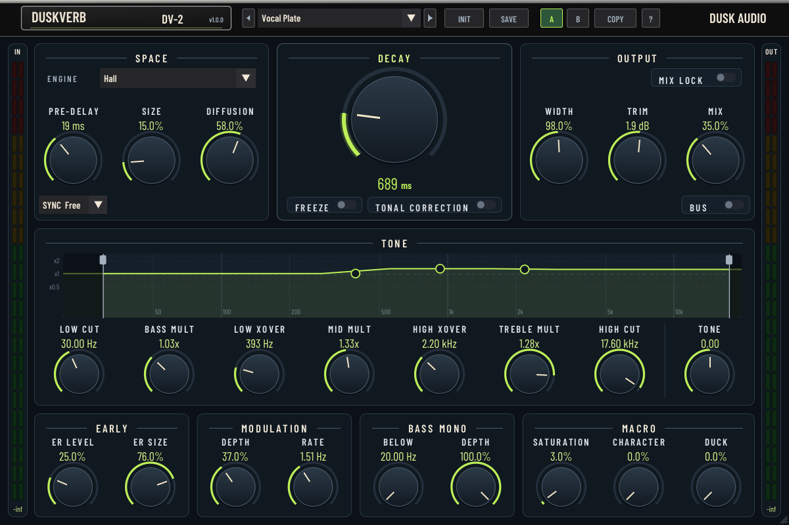

# DuskVerb 2

## Overview

DuskVerb 2 combines the original DuskVerb reverb engines, its own nonlinear
engine and updated voicing with a redesigned interface. Its 45 factory presets
provide starting points for plates, rooms, chambers, halls, auditoriums, springs and nonlinear bursts.
Engine selection changes the reverb topology;
some controls change labels or availability to match the selected engine.

The amber display shows the engine, decay setting and output history. The large
Decay knob sits beside it; Input, Early Reflections, Modulation, Damping, Macro,
Filter and Output controls fill the rows below.

## Quick Start

1. Select a factory preset from the top preset menu. The arrows move through presets.
2. Adjust **Decay** and **Size** to fit the source and arrangement.
3. Set **Mix** for an insert, or enable **Bus** for a fully wet return. Turn on
   **Mix Lock** to keep Mix and Bus where they are while you audition presets.
4. Use **Pre-delay** to separate the source from the reverb. Choose a rhythmic
   division in **Sync** to follow the host tempo.
5. Shape the tail with the **Damping** multipliers and crossover controls.
   Use **Tone** for a broader adjustment, then set **Trim**.
6. Click **Save** to store your sound as a user preset.

## Controls

| Section | Purpose |
|---|---|
| Input | Pre-delay, tempo sync and saturation. |
| Filter | Low Cut, High Cut, Mono Below and Mono Depth. |
| Decay / Size | Tail length and space size. |
| Output | Dry / Wet, Width, Trim and fully wet Bus mode. |
| Early Reflections | Level, size and diffusion. |
| Damping | Three decay multipliers and two crossover frequencies. |
| Modulation | Depth and rate; labels follow the engine. |
| Macro | Tone, Character and Duck. |

Sync retains the free pre-delay setting, and Bus retains the Dry / Wet setting.

**Freeze** holds the reverb on supported engines; it is hidden for Reverse
and Nonlinear. The gated engine also exposes its **Gate** switch. Controls
unused by the selected engine are dimmed.
**Vocal Plate** uses Compact Plate, an eight-delay stereo reverb. **Tonal Correction**
is available for Ambience and for saved sessions using the earlier Vocal Plate
and Tiled Room engines.

**Medium Drum Room** and **Tiled Room** use the Room engine. In Tiled Room,
Decay changes the spacing of the reflections that carry the tail.
The separately importable **Big Drum Room Matched** uses a larger room with
60 ms of reverb pre-delay. Previously saved versions recall the chamber engine.

**Cathedral Large Hall** uses Hall II with a 66 m room and 21 ms of pre-delay.
Separate filters keep the early reflections darker than the tail.

**Vocal Hall** uses the Room engine. Pre-Delay starts at 0 ms for the early
reflections. The late reverb has its own 110 ms pre-delay setting. Decay reads
2.83 s at recall.

Sessions saved with the previous engines recall their original settings.
Reselect the factory preset to hear its current voicing.

On the **Nonlinear** engine, Decay sets the length of the burst: the time it
takes to fall by 60 dB. The burst follows Decay from about 0.27 s up to 2.5 s.
Above 2.5 s the burst stays at 2.5 s, and both the decay readout and the
host's parameter display show 2.50 s (an LV2 host's own display shows the
knob position from 0 to 1, not a time). Below about 0.27 s the burst cannot
get any shorter, so those settings all last about 0.26 s.

The display at the top left shows the engine (click its name to choose another),
the decay time (click it to type a value), the **Freeze**, **Sync** and **Bus**
indicators, and **Output History**. Output History shows recent output level; it
is not a measured RT60 graph, and the decay readout is the parameter setting, not
a guarantee of a measured acoustic decay time. On the Nonlinear engine it shows
at most 2.50 s, the longest burst. The side meters show input and output levels.

Freeze can sustain a tail indefinitely on supported engines. Choose the desired
end of an offline bounce explicitly when using Freeze. CLAP and VST3 report an
infinite frozen tail; AU uses the framework's one-hour fallback because its tail
property has no infinite sentinel. Unfrozen tail estimates include long decay
and damping settings.

## Editing Values

- Drag a knob to adjust it; hold Shift for finer movement.
- Use the mouse wheel to step a value.
- Click a numeric readout or double-click a knob to type a value. Enter applies
  it; Escape cancels. Invalid input stays available for correction.
- Right-click a knob for its reset and value-entry menu.
- Ctrl-click or Alt-click resets a knob on Windows/Linux. On macOS, use
  Alt-click or Cmd-click.
- Drag the editor corner to resize. The minimum size is 1050 × 700.
- Click **?** for the in-plugin control reference. The amber display also shows
  this instance's approximate CPU load.

## Presets and Comparison

**INIT** restores defaults. Factory recall applies the factory sound while
preserving the settings intentionally excluded by the original preset format.
An asterisk beside the preset name indicates an edited sound. **Mix Lock**,
below the Bus switch, keeps Dry / Wet and Bus unchanged on preset recall and
INIT; A/B still restores the complete sound.

The factory menu groups the 21 additional presets by family.

| Factory menu group | Presets |
|---|---|
| Chambers II | Warm Chamber, Medium Chamber, Dark Chamber |
| Auditoriums | Small Wood Room, Vocal Concert Hall, Concert Hall |
| Halls II | Wide Hall, Studio Hall, Large Warm Hall |
| Studio Plates | Large Plate, Tight Plate, Small Plate |
| Modulated Halls | Lush Hall Medium, Lush Hall Long, Lush Hall Dark |
| Rooms II | Tight Live Room, Theater Room, Dark Drum Room |
| Vintage Plates | Vintage Plate, Vintage Bright Plate, Short Vocal Plate |

**A** and **B** switch between complete comparison snapshots. **COPY** copies
the active sound into the other slot without switching. Save sounds you want
to keep as user presets; comparison slots are a working audition tool.

The Save dialog requires explicit replacement confirmation for an existing
name. Names that map to the same filename, such as `Alpha/Beta` and
`Alpha-Beta`, receive distinct filenames. Right-click a user preset to delete
it. The preset menu also offers import of original DuskVerb preset files.
Malformed imports are rejected without partially applying their values.

User presets are stored in the `DuskAudio/DuskVerb2/presets` subdirectory
of the following configuration folder:

- Linux: `$XDG_CONFIG_HOME`, or `~/.config` when XDG_CONFIG_HOME is unset.
- macOS: `~/.config`.
- Windows: `%APPDATA%`, with LOCALAPPDATA as fallback.

Safe publication of new presets requires a filesystem with hard-link support.
A save failure is reported rather than replacing an unrelated preset.

## Compatibility

DuskVerb 2 has its own plugin identity and can coexist with the original
DuskVerb. Importing an original preset does not convert a DAW project or
replace an original plugin instance. Keep the original plugin available for
projects that use it.

The VST3 identity is the same on Windows, Linux and macOS. The first Windows
build, 1.0.0, had a different one. A Windows project saved with 1.0.0 opens in a
host that reads VST3 compatibility information, as REAPER does. In a host that
does not, the project reports DuskVerb 2 as missing and does not load its
settings. If 1.0.0 is still installed, open the project with it before updating
and save each instance's settings as a user preset; after the update insert
DuskVerb 2, load the preset, and check automation and routing. If 1.0.0 is gone
and no such preset was saved, the settings in that project cannot be brought
back in that host: insert DuskVerb 2 and set it up again. CLAP, AU and LV2
projects are not affected.
Original DuskVerb has a separate identity and is unaffected.

The plugin supports mono, mono-to-stereo and stereo operation where the host
exposes those layouts. Select the appropriate host routing before playback.

In version 1.0.1 the Nonlinear burst stopped getting longer at a Decay of
783 ms. A project saved with 1.0.1 on the Nonlinear engine with Decay above
783 ms played that 783 ms burst and now plays the Decay it shows; set Decay
to 783 ms to get the old length back (when typing it, include the unit).
Recorded Decay automation above 783 ms likewise now plays what it says.

Version 1.0.2 retunes five factory presets: Vocal Plate, Vintage Vocal
Plate, Medium Drum Room, Vocal Hall and Deep Blue Day. A project saved with
1.0.1 on Vocal Plate, Vintage Vocal Plate or Medium Drum Room plays the
retuned sound. A project on Vocal Hall or Deep Blue Day keeps the settings it
saved and sounds as before; select the preset again to get the retuned
version.
