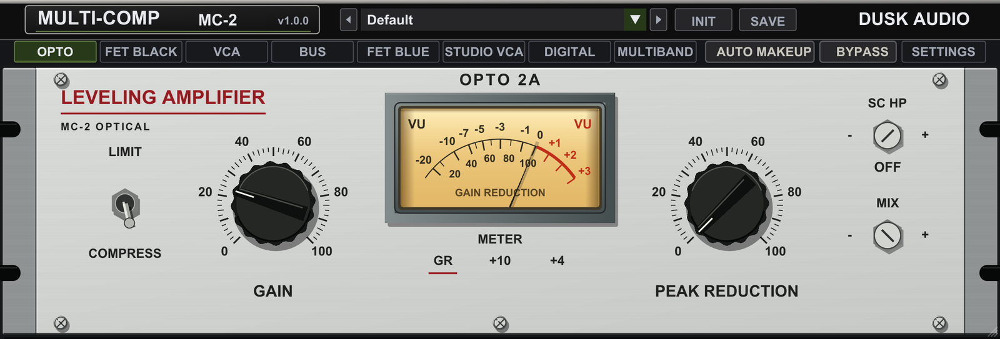
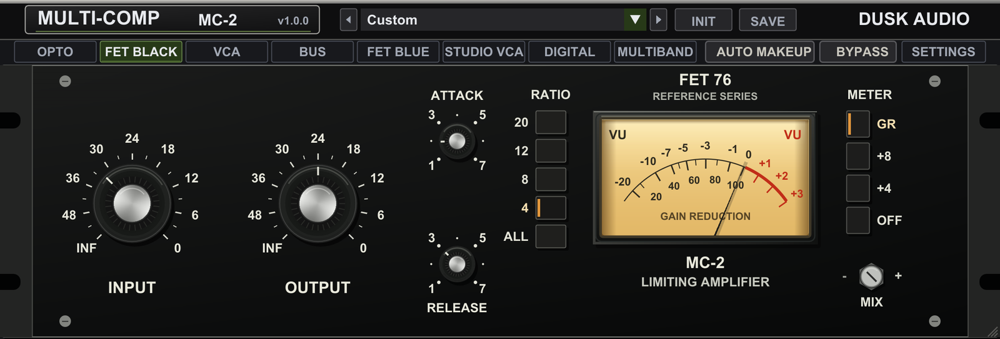
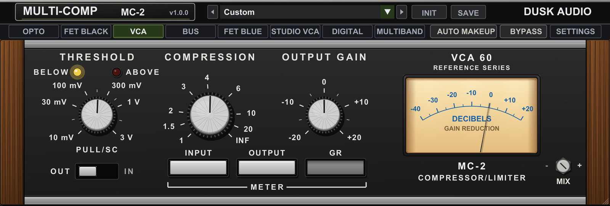
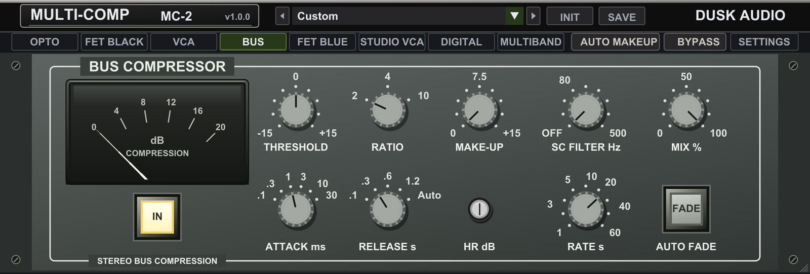
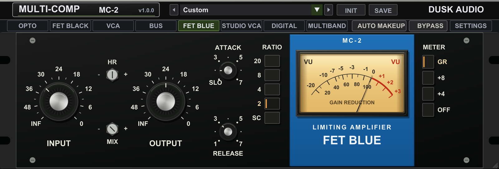
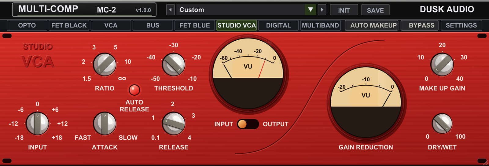
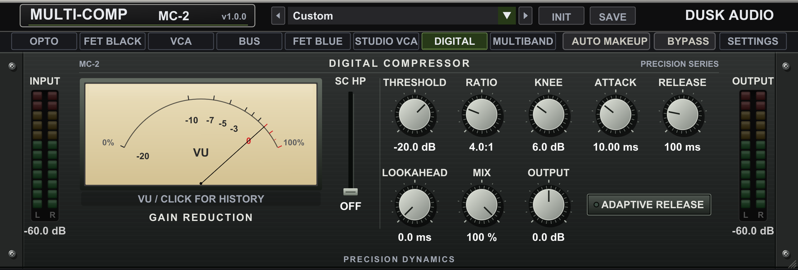
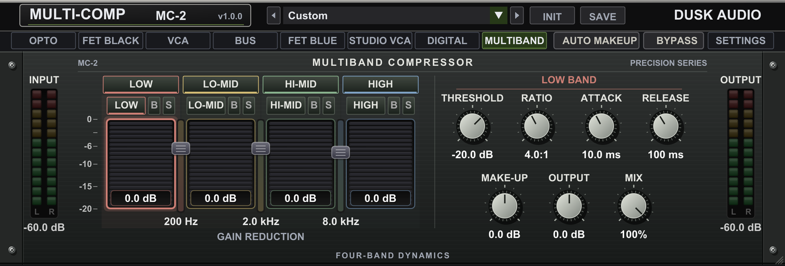
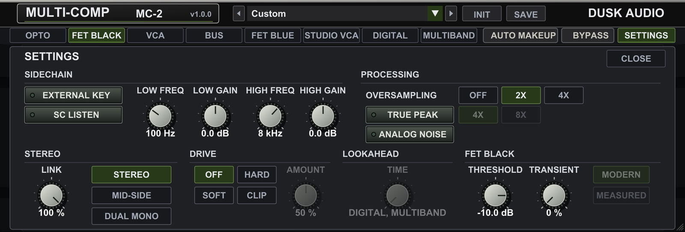

# Multi-Comp 2

## Overview

Multi-Comp 2 (MC-2) puts eight compressors in one plugin. Click a tab in the mode row and the face below it changes to that compressor's own panel, with its own controls and meter. The window stays 1120 x 380 in every mode.

Six modes follow a reference unit. Each was measured against its reference control by control, so a setting on the face is meant to do what the same setting does on the reference; the differences that remain are listed under Tips and Traps. DIGITAL and MULTIBAND have no reference: they are clean compressors for when you want exact numbers for knee, attack, release and lookahead, or control over separate frequency bands.

| Tab | Follows | Reach for it on |
| --- | --- | --- |
| OPTO | a classic optical leveling amplifier | vocals, bass, smooth leveling |
| FET BLACK | a classic FET limiting amplifier | drums, aggressive vocals, parallel crush |
| VCA | a classic VCA compressor/limiter | kick, snare, bass |
| BUS | a classic console bus compressor | drum bus, mix bus |
| FET BLUE | a second FET limiter, with a 2:1 ratio and a SLO attack | vocals, gentler FET control |
| STUDIO VCA | a clean studio VCA compressor | acoustic instruments, master bus |
| DIGITAL | no reference | precise peak control with lookahead |
| MULTIBAND | no reference | de-essing, one problem band |

MC-2 is a compressor, not a brickwall limiter; put a limiter after it when you need a hard ceiling. It has its own plugin identity, so it installs beside the original Multi-Comp and does not replace it in existing sessions.

## Quick Start

1. Download MC-2 from its page on the Dusk Audio website, <https://dusk-audio.github.io/plugins/multi-comp-2/>, which lists the formats for each platform. Insert it on a mono or stereo track or bus.
2. Click a mode tab. If you are unsure, start with OPTO on a vocal or bass, FET BLACK or VCA on drums, and BUS on a drum bus or the mix bus.
3. Turn the face's amount control until the meter shows 3 to 6 dB of gain reduction on the loud parts:
   - OPTO: PEAK REDUCTION. At its default, 0, OPTO does not compress at all.
   - FET BLACK and FET BLUE: INPUT. There is no threshold on these faces; more INPUT means more compression.
   - VCA, BUS, STUDIO VCA and DIGITAL: THRESHOLD.
   - MULTIBAND: each band's THRESHOLD.
4. Bring the level back with the face's output control (GAIN, OUTPUT, OUTPUT GAIN, MAKE-UP or MAKE UP GAIN), or switch on AUTO MAKEUP in the mode row.
5. Compare against BYPASS at matched level. For parallel compression, pull the face's MIX (DRY/WET on STUDIO VCA) below 100%.

You should hear the loud passages come down while the quiet ones stay where they are. If the low end pumps, raise the sidechain high-pass (SC HP, SC FILTER or PULL/SC, depending on the face) so kick and bass stop driving the detector. Everything that has no home on a face, such as the external sidechain, oversampling, stereo link, drive and lookahead, sits in the SETTINGS drawer at the right end of the mode row.

## Workflows

### Lead vocal leveling with OPTO

**Source:** a pop or rock lead vocal around -18 dBFS RMS, peaks near -6 dBFS.

**Goal:** 3 to 5 dB of steady reduction across verse and chorus, with no audible grab on consonants.

- OPTO tab, lever on COMPRESS
- PEAK REDUCTION 50
- GAIN 29 (about +5 dB of makeup)
- SC HP 60 Hz
- MIX 100%

Why this works: an optical cell sets its own attack and release from the program, so PEAK REDUCTION is the only depth control you need, and the SC HP keeps breaths and rumble from pushing the cell. With METER on GR, raise PEAK REDUCTION toward 60 if the needle shows less than 3 dB on the loud lines; if the vocal starts to sound held down, back it off toward 40. These are the settings of the Smooth Opto Vocal preset.

### Parallel drum crush with FET BLACK

**Source:** room mics, or a copy of the drum bus on an aux, peaking around -10 dBFS.

**Goal:** a dense, pumping room sound blended under the dry kit.

- FET BLACK tab, RATIO ALL
- INPUT around +24 on its readout, until the needle drops past -10 on every hit
- ATTACK 3, RELEASE 7
- OUTPUT around -8, then match the crushed level to the dry kit
- MIX 40%, or 100% on an aux that you blend with its fader

Why this works: ALL is the deepest and most aggressive ratio, and RELEASE 7, the fastest position, lets the room swell back up between hits. That swell is what you blend in under the dry drums. On the FET dials 7 is the fastest and 1 the slowest, so lower ATTACK numbers let more of each hit through before the clamp. The Room Nuke (FET All) preset starts from ALL with a much slower RELEASE (about 1.6); turn it up for more pump.

### Drum bus glue with BUS

**Source:** a stereo drum bus peaking around -10 dBFS.

**Goal:** 2 to 4 dB of reduction, with kick and snare still punching through.

- BUS tab, RATIO 4
- THRESHOLD -15 dB, then adjust until the dB COMPRESSION meter swings 2 to 4 dB
- ATTACK 30 ms, RELEASE Auto
- SC FILTER 90 Hz
- MAKE-UP 3 dB, with AUTO MAKEUP off
- MIX 100%, HR 16 dB

Why this works: the slowest attack lets each transient through before the bus clamps, Auto release follows the program instead of a fixed time, and the SC FILTER keeps every kick from pulling the whole kit down. On a mix bus, use RATIO 2 and ATTACK 10 ms and aim for 1 to 3 dB. The Classic Drum Glue and Console-Style Glue presets start here, with AUTO MAKEUP on.

### De-essing a vocal with MULTIBAND

**Source:** a lead vocal with harsh sibilance between 6 and 9 kHz.

**Goal:** 4 to 8 dB off the "s" sounds and nothing anywhere else.

- MULTIBAND tab. In the top strip, click LOW and LO-MID to disable them. HI-MID and HIGH remain; MULTIBAND always keeps two bands, so those two now lock.
- Drag the crossover handle between HI-MID and HIGH down to 6.0 kHz.
- Click the HI-MID tab and set RATIO to 1.0:1, so that band passes untouched.
- Click the HIGH tab: THRESHOLD -30 dB, RATIO 6.0:1, ATTACK 1.0 ms, RELEASE 80 ms, MAKE-UP 0 dB.
- MIX 100%.

Why this works: with two bands left, one crossover splits the vocal at 6 kHz and only the band above it compresses, so the body of the voice is never touched. Watch the HIGH meter: it should read 4 to 8 dB on the loudest "s" and close to 0 dB elsewhere. Click the S button beside the HIGH tab to hear what the band catches, and click it again before you move on.

### Speech peak control with DIGITAL

**Source:** a podcast or dialogue voice whose plosives and laughs jump 10 dB above the body of the speech.

**Goal:** peaks held close to the body, with recovery quick enough that pauses do not pump.

- DIGITAL tab: THRESHOLD -18 dB, RATIO 8.0:1, KNEE 6.0 dB, ATTACK 1.00 ms, RELEASE 120 ms
- LOOKAHEAD 3.0 ms, ADAPTIVE RELEASE on, MIX 100%
- SC HP slider at 80 Hz
- OUTPUT to taste, or AUTO MAKEUP on (OUTPUT then greys out)
- In SETTINGS: TRUE PEAK on, 4X

Why this works: LOOKAHEAD delays the audio by 3 ms, so the detector sees each plosive before it arrives and a 1 ms attack catches its front. ADAPTIVE RELEASE stretches the release on dense passages and shortens it after isolated peaks, and TRUE PEAK makes the detector react to peaks that fall between samples. The 3 ms of lookahead adds to MC-2's latency, which your host compensates on playback.

## Parameter Reference

Setting a value works like this:

- Drag a knob up or down; hold Shift for finer steps. The mouse wheel steps it too, finer with Shift.
- Alt-click (Option-click) returns a control to its default, as does Cmd-click on macOS and Ctrl-click on Windows and Linux.
- On the six hardware faces (OPTO, FET BLACK, VCA, BUS, FET BLUE, STUDIO VCA), double-click also resets, and right-click opens a menu with Reset to default and Type value. On BUS's stepped knobs (RATIO, ATTACK, RELEASE) the right-click menu lists their positions. These faces show a knob's value while you drag it.
- On DIGITAL, MULTIBAND and in the SETTINGS drawer, double-click a knob to type a value. Each knob's value is printed under it.

### Header and mode row

- **Preset list:** the 13 factory presets, then your own under User. It reads Default at the INIT state, a preset's name while every control that preset sets still matches it, and Custom otherwise; picking any mode but OPTO from the INIT state already reads Custom. The arrows on either side step through the factory presets and stop at the ends.
- **INIT:** returns every control to its default, including the mode (OPTO) and everything in SETTINGS. BYPASS is left as it is.
- **SAVE:** stores every control except BYPASS as a user preset. Saving under an existing name replaces that preset. User presets are files in `DuskAudio/MultiComp2/presets` inside your configuration folder: `~/.config` on macOS, `$XDG_CONFIG_HOME` (or `~/.config` when it is unset) on Linux, and `%APPDATA%` on Windows.
- **Title plate:** click MULTI-COMP MC-2 to see the project's supporters.
- **Mode tabs:** default OPTO. Each mode keeps its own settings while you visit the others, apart from the shared controls listed under Tips and Traps. A mode change ducks the output for a few milliseconds so it does not click.
- **AUTO MAKEUP:** off by default. It matches the output's loudness to the input's (RMS over about two seconds, within 12 dB either way) and sets the face's own output or makeup control aside while it runs. It switches itself off while EXTERNAL KEY is in use.
- **BYPASS:** off by default. A 30 ms crossfade to the input, delayed by MC-2's latency, so bypassing never shifts the track's timing.
- **SETTINGS:** opens the drawer described at the end of this section.
- **Window:** opens at 1120 x 380, which is also the minimum. Drag the lower-right corner to make it larger; everything scales together.

### OPTO

The OPTO face is shown in the Overview.

- **PEAK REDUCTION:** 0 to 100, default 0. The amount of compression; at 0 nothing is compressed. Start around 40 to 60 and set it by the needle, not by the number.
- **GAIN:** 0 to 100, default 20. Output level after the cell: 20 is unity, 100 is about +38 dB, and 0 mutes the output, as on the reference.
- **LIMIT / COMPRESS:** click the toggle; default COMPRESS. LIMIT clamps harder, COMPRESS is gentler.
- **SC HP:** set screw, OFF to 500 Hz, default OFF. A high-pass on the detector only, never on the audio. Raise it to 60 to 120 Hz when bass drives too much reduction.
- **MIX:** set screw, 0 to 100%, default 100%. Dry/wet blend for parallel compression.
- **METER:** GR (default), +10 or +4. GR shows gain reduction; +10 and +4 show output level, with 0 VU at -12 dBFS RMS and -18 dBFS RMS respectively. The meter switch changes only the display.

### FET BLACK

- **INPUT:** -20 to +40 on its readout, default 0. The drive into the unit, and so the amount of compression. The ring is printed like the reference's input dial (INF to 0); the readout is the control's own scale, not gain in dB.
- **OUTPUT:** -20 to +20 on its readout, default 0. Output level. Set INPUT for the compression first, then OUTPUT for the level.
- **ATTACK:** dial 1 to 7, default about 2. As on the reference, 7 is the fastest and 1 the slowest.
- **RELEASE:** dial 1 to 7, default 3. Again 7 is the fastest. Fast releases add energy and audible pumping; slow ones even things out.
- **RATIO:** 20, 12, 8, 4 or ALL; default 4. ALL is the deepest, most aggressive setting. Switching into or out of ALL ducks the output for a few milliseconds.
- **METER:** GR (default), +8, +4 or OFF. +8 and +4 show output level, with 0 VU at about -17 dBFS RMS and -21 dBFS RMS. OFF is MC-2's BYPASS, the way the reference's meter switch turns the unit off; choose a meter position to bring the compressor back.
- **MIX:** set screw, 0 to 100%, default 100%.
- FET BLACK also has THRESHOLD, TRANSIENT and CURVE controls; they are in the SETTINGS drawer.

### VCA

- **THRESHOLD:** -55 to 0 dB, default -27 dB. The ring carries the reference's printed scale (10 mV to 3 V); the readout is in dB. BELOW lights amber while the input sits under the threshold, ABOVE lights red from the threshold up.
- **COMPRESSION:** 1:1 to INF, default about 4.2:1. The readout shows the ratio the compressor applies. Near the end stop it reads INF, where the reference compresses slightly past infinity (louder input, slightly quieter output).
- **OUTPUT GAIN:** -20 to +20 dB, default 0 dB.
- **PULL/SC:** OUT (default) or IN. IN switches the detector to the reference's sidechain response, a gentle tilt of about 3 dB per octave that is flat near 290 Hz, so lows push less and highs push more. It shares its on/off state with the SC HP of OPTO, BUS and DIGITAL: OUT sets that control to OFF, and IN turns it back on at its last cutoff, or at 20 Hz.
- **METER keys:** INPUT, OUTPUT or GR (default). INPUT and OUTPUT read peak level with 0 on the DECIBELS scale at -12 dBFS. The choice is not saved with the session.
- **MIX:** set screw, 0 to 100%, default 100%.
- VCA has no attack or release controls: its timing follows the reference's program-dependent detector.

### BUS

- **THRESHOLD:** -15 to +15 dB, default 0 dB.
- **RATIO:** 2, 4 or 10; default 2.
- **MAKE-UP:** 0 to +15 dB, default 0 dB.
- **SC FILTER Hz:** OFF to 500 Hz, default OFF. A high-pass on the detector; 60 to 100 Hz keeps the kick from driving the bus.
- **MIX %:** 0 to 100%, default 100%. BUS's own blend.
- **ATTACK ms:** 0.1, 0.3, 1, 3, 10 or 30; default 1. 10 and 30 let transients through.
- **RELEASE s:** 0.1, 0.3, 0.6, 1.2 or Auto; default 0.3. Auto follows the program.
- **HR dB:** 4 to 28 dB in 4 dB steps, default 16 dB. How hot the modeled console stage runs: higher settings drive it harder, so it saturates and clips sooner. At 28 dB its output clips just under 0 dBFS; at 4 dB it practically never clips.
- **RATE s:** 1 to 60 s, default 24.8 s. The length of the AUTO FADE.
- **AUTO FADE:** press FADE to fade the output down to silence over RATE seconds, the way you would fade out a song; press it again to fade back up. The button flashes while the fade moves.
- **IN:** MC-2's BYPASS, lit while the compressor is in circuit.
- The meter reads gain reduction from 0 to 20 dB.

### FET BLUE

FET BLUE shares INPUT, OUTPUT, ATTACK, RELEASE and the METER buttons with FET BLACK: they are the same controls, so a change on one face shows on the other.

- **ATTACK:** as FET BLACK, except that its slowest stop is the SLO detent: a much slower attack with a slightly raised threshold, as on the reference. The readout says SLO there; type SLO to set it.
- **RATIO:** 20, 8, 4 and 2; default 2. Press one button, or two together: a second button joins the lit one, a third replaces the pair, and pressing a lit button releases it. With no button lit, FET BLUE does not compress, but the signal still passes through its amplifier.
- **SC:** off by default. A filter on the detector, a tilt of about 3 dB per octave that is flat near 285 Hz: lows drive less reduction, highs more.
- **HR:** 4 to 28 dB in 4 dB steps, default 16 dB. Each step above 16 drives the gain stage 4 dB harder and trims the output back by the same amount, so you get more reduction at the same INPUT with no change in level below the threshold. Steps below 16 do the opposite.
- **MIX:** set screw, 0 to 100%, default 100%.

### STUDIO VCA

- **INPUT:** -18 to +18 dB, default 0 dB. Level into the compressor; more INPUT means more reduction and a louder output.
- **RATIO:** 1.5:1 to infinity (50:1), default 1.5:1.
- **THRESHOLD:** -50 to -10 dB, default -10 dB.
- **ATTACK:** FAST (0.18 ms) to SLOW (about 71 ms), default 7.23 ms.
- **RELEASE:** 0.1 to 4 s, default 1 s. Ignored while AUTO RELEASE is on.
- **AUTO RELEASE:** lamp, on by default. A program-dependent release in place of the RELEASE knob.
- **MAKE UP GAIN:** 0 to 40 dB, default 0 dB.
- **DRY/WET:** 0 to 100%, default 100%. This is the same control as the MIX on OPTO, FET BLACK, VCA and FET BLUE.
- **Meters:** the left meter shows INPUT (default) or OUTPUT level from -60 to 0 dB, chosen with the switch under it; on INPUT a red needle marks the THRESHOLD. The right meter shows gain reduction from 0 to 20 dB.
- STUDIO VCA is a clean design and always runs at the host rate, like its reference, so OVERSAMPLING has no effect here.

### DIGITAL

- **THRESHOLD:** -60 to 0 dB, default -20 dB.
- **RATIO:** 1:1 to 100:1, default 4:1.
- **KNEE:** 0 to 20 dB, default 6 dB. The width of the soft knee around the threshold; 0 is a hard knee.
- **ATTACK:** 0.01 to 500 ms, default 10 ms.
- **RELEASE:** 1 to 5000 ms, default 100 ms.
- **LOOKAHEAD:** 0 to 10 ms, default 0 ms. Delays the audio so the detector reacts before a peak arrives, and adds the same time to MC-2's latency. It adds to the LOOKAHEAD TIME in SETTINGS.
- **MIX:** 0 to 100%, default 100%. DIGITAL's own blend.
- **OUTPUT:** -24 to +24 dB, default 0 dB. Greyed out while AUTO MAKEUP is running.
- **ADAPTIVE RELEASE:** off by default. Scales RELEASE by how dense the program is: up to twice as long on dense material, down to a third on spiky material.
- **SC HP:** vertical slider, OFF to 500 Hz, default OFF; double-click it to return to OFF.
- **GAIN REDUCTION display:** a VU with a peak marker that holds for 2 s. Click it to see the last 4 seconds as a GR HISTORY trace, and click again to go back.
- **INPUT and OUTPUT meters:** peak level per channel, with the loudest recent peak printed underneath.

### MULTIBAND

- **Band strip:** LOW, LO-MID, HI-MID and HIGH switch each band on or off; all on by default. A disabled band's range merges into its enabled neighbor. At least two bands stay on, so the last two lock.
- **Band tabs:** click a band's name to show its knobs on the right. B bypasses that band, S solos it.
- **Crossover handles:** drag the handle between two band meters up or down; double-click returns it to its default. Crossover 1 runs 20 to 500 Hz (default 200 Hz), crossover 2 200 Hz to 5 kHz (default 2 kHz), crossover 3 2 to 16 kHz (default 8 kHz). Each crossover stays at least 1.5 times above the one below it, so raising a lower handle can push a higher one.
- **Per band:** THRESHOLD -60 to 0 dB (default -20 dB), RATIO 1:1 to 20:1 (default 4:1), ATTACK 0.1 to 100 ms (default 10 ms), RELEASE 10 to 1000 ms (default 100 ms), MAKE-UP -12 to +12 dB (default 0 dB). Every band uses a fixed 6 dB soft knee.
- **OUTPUT:** -24 to +24 dB, default 0 dB, greyed out while AUTO MAKEUP is running. **MIX:** 0 to 100%, default 100%.
- **Band meters:** each band's gain reduction from 0 to 20 dB, with its value printed underneath.
- MULTIBAND runs no oversampling, and each band compresses each channel on its own, so the stereo LINK in SETTINGS has no effect here.

### SETTINGS drawer

SETTINGS in the mode row opens a drawer over the face with every control that no face carries. It closes when you click CLOSE, SETTINGS again, a mode tab, or anywhere outside the panel, or when you press Escape. A control that the current mode ignores stays in place, greyed out.

**SIDECHAIN**

- **EXTERNAL KEY:** off by default. The detector listens to the signal your host sends to MC-2's sidechain input instead of the track. Route the key in your host first; while the host provides no sidechain input, MC-2 keeps using the track. A mono key drives both channels. AUTO MAKEUP is set aside while the key is in use.
- **SC LISTEN:** off by default. Replaces the output with the detector's signal, after its filters, the sidechain EQ and TRUE PEAK, so you hear what drives the compression. The gain reduction meters rest while you listen. Turn it off before you bounce.
- **LOW FREQ / LOW GAIN:** a low shelf on the detector, 60 to 500 Hz (default 100 Hz), -12 to +12 dB (default 0 dB). **HIGH FREQ / HIGH GAIN:** a high shelf, 2 to 16 kHz (default 8 kHz), -12 to +12 dB (default 0 dB). Both act on the detector only, in every mode. Cut LOW GAIN to stop bass from driving the compressor; boost HIGH GAIN to make it react to sibilance or cymbals.

**PROCESSING**

- **OVERSAMPLING:** OFF, 2X or 4X; default 2X. Runs the compressor and DRIVE at two or four times the host rate to keep their distortion from aliasing; 4X costs the most CPU. OPTO, FET BLACK and FET BLUE were tuned at 2X. Changing it ducks the output briefly but never changes the latency. Greyed out in STUDIO VCA and MULTIBAND, which do not oversample.
- **TRUE PEAK:** off by default, with 4X (default) or 8X precision. The detector reads true peaks, including those that fall between samples, instead of the sample values. It changes what triggers the compression, not the audio. In MULTIBAND it applies only while EXTERNAL KEY is in use.
- **ANALOG NOISE:** off by default. Adds a faint hiss, about -85 dBFS RMS, in every mode except DIGITAL and MULTIBAND.

**STEREO**

- **LINK:** 0 to 100%, default 100%. With STEREO selected, how far each channel follows the louder one: at 100% both channels move together and the stereo image holds still; at 0% each channel compresses on its own. It has no effect with MID-SIDE or DUAL MONO, and none in MULTIBAND.
- **STEREO / MID-SIDE / DUAL MONO:** default STEREO. MID-SIDE compresses the mid (L+R) and side (L-R) signals separately, each on its own detector. DUAL MONO runs the two channels as two independent compressors.

**DRIVE**

- **OFF / SOFT / HARD / CLIP:** default OFF. A waveshaper after the compressor, in every mode, running inside the oversampled path in the modes that oversample. SOFT rounds peaks and also lifts quiet material, by about 3.5 dB at the default AMOUNT and 6 dB at full AMOUNT. HARD bends peaks above a point that falls from just under 0 dBFS to about -3 dBFS as AMOUNT rises, negative peaks slightly earlier. CLIP cuts flat at a ceiling that falls from about +6 dBFS at low AMOUNT to 0 dBFS at 100%.
- **AMOUNT:** 0 to 100%, default 50%; greyed out while DRIVE is OFF. At 0% the waveshaper leaves the signal untouched.

**LOOKAHEAD**

- **TIME:** 0 to 10 ms, default 0 ms. DIGITAL and MULTIBAND only: delays the audio so the detector sees peaks that much early, and adds the same time to MC-2's latency. The other six modes ignore it completely, with no delay and no added latency; there the knob greys out and reads DIGITAL, MULTIBAND. In DIGITAL it adds to the face's own LOOKAHEAD.

**FET BLACK** (FET BLACK only)

- **THRESHOLD:** -60 to 0 dB, default -10 dB, the reference unit's own fixed threshold. Lower values compress more at the same INPUT.
- **TRANSIENT:** 0 to 100%, default 0%. Eases off the reduction on detected transients so the front of each hit comes through; 0% is off.
- **MODERN / MEASURED:** the CURVE, default MODERN; active only with RATIO on ALL. MODERN is the all-buttons behavior matched to the reference. MEASURED switches to the all-buttons curve of the original Multi-Comp's Measured mode, with its small level sag (0.75 dB) once more than 15 dB of reduction has held for 0.1 s; on quiet material it sits about 1.2 dB below the reference. Leave it on MODERN unless you want that older curve.

## Tips and Traps

- **Shared controls.** OPTO, FET BLACK, VCA, FET BLUE and STUDIO VCA share one MIX (DRY/WET on STUDIO VCA); BUS, DIGITAL and MULTIBAND each have their own. FET BLACK and FET BLUE share INPUT, OUTPUT, ATTACK, RELEASE and METER. OPTO's SC HP, VCA's PULL/SC, BUS's SC FILTER and DIGITAL's SC HP are one setting, which every factory preset writes; FET BLACK, FET BLUE, STUDIO VCA and MULTIBAND ignore it.
- **Two more bypass switches.** The FET faces' METER OFF button and the BUS face's IN button are the same BYPASS as the mode row's.
- **AUTO MAKEUP takes over the output control on every face,** but only DIGITAL and MULTIBAND grey theirs out. Five factory presets switch it on.
- **Latency is fixed.** MC-2 reports the same latency in every mode and in bypass: 73 samples at 44.1 and 48 kHz (about 1.5 ms), 79 at 88.2 and 96 kHz, 91 at 176.4 and 192 kHz. Switching modes never shifts the track. Only the lookaheads in DIGITAL and MULTIBAND add to it; set them before you record or bounce, because some hosts read a new latency only when playback restarts.
- **Switches duck.** A mode change, an OVERSAMPLING change and FET BLACK's RATIO moving into or out of ALL dip the output for a few milliseconds, and a newly entered mode (or ALL) starts from rest. Avoid automating them under exposed material.
- **Factory presets leave SETTINGS alone,** apart from FET BLACK presets, which return the drawer's FET BLACK group to its defaults. User presets restore everything except BYPASS.
- **FET automation readouts.** In your host's automation lanes, FET Attack and FET Release keep the millisecond scale of the original Multi-Comp. Those numbers rise toward the fast end of the dial and are not attack or release times; set the timing with the 1 to 7 dials on the face.

### Known differences from the reference units

These are the measured readings that still differ from the reference by more than 1 dB:

- **OPTO:** hot bursts about 1 ms long get up to about 1.9 dB less reduction; with LIMIT, deep PEAK REDUCTION and the stereo link on, low tones whose two channels are offset in phase get up to about 1.7 dB more. A few harmonic readings differ by up to about 1.9 dB, and distortion products on two-tone and swept-tone tests often differ by more than 2 dB.
- **FET BLACK:** at RATIO ALL the reference lets go within about 20 ms after a burst, while MC-2 still holds about 2 dB at 50 ms. A few harmonic readings differ by up to about 3 dB.
- **FET BLUE:** at RELEASE 7, 50 ms after a 20 ms hit, MC-2 holds up to about 2.5 dB more reduction than the reference.
- **BUS:** at RATIO 10 with ATTACK 0.1 ms, the first millisecond of a hit from silence gets about 1.4 dB less reduction.
- **VCA and STUDIO VCA:** no measured reading is more than 1 dB off.

## Presets Explained

MC-2 ships with 13 factory presets, listed in the header in the order below. A factory preset sets its mode, that mode's face controls, and the shared MIX, SC HP and AUTO MAKEUP. Each one is a starting point: set the amount control for your source first.

### Vocals

- **Smooth Opto Vocal.** OPTO: PEAK REDUCTION 50, GAIN 29 (about +5 dB), COMPRESS, SC HP 60 Hz. Steady level on a lead vocal; move PEAK REDUCTION first.
- **Vocal Presence.** FET BLACK at 4: INPUT +20, OUTPUT -11, ATTACK about 2.3, RELEASE about 1, the slow end. A forward rock or indie vocal. Set the depth with INPUT; turn RELEASE up toward 5 if the vocal should recover faster.
- **Modern Pop Control.** FET BLUE at 8: INPUT +15, ATTACK about 2.1, RELEASE about 1.4, HR 16 dB, AUTO MAKEUP on (its OUTPUT of +3 is set aside). Tight control of a pop vocal; set INPUT, then decide whether you want AUTO MAKEUP.

### Drums

- **Classic Drum Glue.** BUS: THRESHOLD -15 dB, RATIO 4, ATTACK 30 ms, RELEASE Auto, SC FILTER 90 Hz, AUTO MAKEUP on (its MAKE-UP of 3 dB is set aside). The drum bus; set THRESHOLD for 2 to 4 dB on the meter.
- **Room Nuke (FET All).** FET BLACK at ALL: INPUT +24, OUTPUT -8, ATTACK about 2.5, RELEASE about 1.6, MIX 100%. Room mics crushed for parallel use; pull MIX down or blend on an aux, and turn RELEASE toward 7 for more pump.
- **Snare Snap.** VCA: THRESHOLD -18 dB, COMPRESSION 4.0:1, OUTPUT GAIN +4 dB, PULL/SC IN. One snare track; set THRESHOLD so ABOVE lights on every hit.

### Bass

- **Rock Bass Anchor.** FET BLACK at 4: INPUT +15, OUTPUT -8, ATTACK about 2.5, RELEASE about 2.1. An even DI or amp bass; set INPUT for 4 to 8 dB on the needle.
- **Vintage Pinned Bass.** OPTO: PEAK REDUCTION 67, GAIN 31 (about +6 dB), COMPRESS, SC HP 30 Hz. Bass held flat under the mix; back PEAK REDUCTION off if the notes lose their front.

### Guitars

- **Acoustic Strum Tamer.** STUDIO VCA: THRESHOLD -22 dB, RATIO 3:1, ATTACK 2 ms, RELEASE 0.1 s with AUTO RELEASE off, AUTO MAKEUP on (its MAKE UP GAIN of 2 dB is set aside). Strumming spikes on an acoustic guitar; set THRESHOLD, then try AUTO RELEASE if the strums flutter.
- **Funk Rhythm Guitar.** FET BLACK at 4: INPUT +12, OUTPUT +4, ATTACK about 2.1, RELEASE 1, the slowest. Clean rhythm parts; turn RELEASE toward 6 or 7 for a faster recovery between strokes.

### Mix Bus

- **Console-Style Glue.** BUS: THRESHOLD -20 dB, RATIO 4, ATTACK 10 ms, RELEASE Auto, SC FILTER 60 Hz, MAKE-UP 0 dB, AUTO MAKEUP on. The mix bus; set THRESHOLD for 1 to 3 dB of reduction and consider RATIO 2.
- **Gentle Master.** STUDIO VCA: THRESHOLD -24 dB, RATIO 1.5:1, ATTACK 30 ms, RELEASE 0.1 s with AUTO RELEASE off, AUTO MAKEUP on. A low-ratio master bus; set THRESHOLD for 1 to 2 dB, and try AUTO RELEASE for a smoother recovery.

### Creative

- **EDM Pump (115-130 BPM).** FET BLACK at 20: INPUT +10, OUTPUT +6, ATTACK about 1.8, RELEASE about 2.1. Deep pumping on a full loop or a pad; set RELEASE by ear so the level swells back in time with the beat.

## Troubleshooting

**I hear nothing.** OPTO's GAIN at 0 mutes the output (20 is unity). On BUS, an engaged AUTO FADE fades everything out over RATE seconds; press FADE again. SC LISTEN plays the detector's signal instead of the track, which is silent when EXTERNAL KEY is on and the key carries nothing.

**Nothing compresses.** OPTO does nothing at PEAK REDUCTION 0, its default, and FET BLUE does not compress with no RATIO button lit. Check BYPASS in the mode row, METER OFF on the FET faces and IN on the BUS face: all three are the same bypass. With EXTERNAL KEY on, MC-2 compresses only when the key signal is there.

**The face's output or makeup control does nothing.** AUTO MAKEUP is on and has taken over the level. Switch it off to set the level by hand.

**Lookahead does nothing.** The LOOKAHEAD TIME in SETTINGS works only in DIGITAL and MULTIBAND; the other modes ignore it by design.

**Bass pumps the whole mix.** Raise SC HP, SC FILTER or PULL/SC on faces that have one. In FET BLACK, FET BLUE and STUDIO VCA, cut LOW GAIN in SETTINGS instead (FET BLUE also has its SC button).

**An LV2 host's preset menu resets my settings.** In an LV2 host, a factory preset chosen from the host's own preset menu also returns every control the preset does not own (BYPASS, OVERSAMPLING, EXTERNAL KEY, LOOKAHEAD, LINK and the rest of SETTINGS) to its default. Choose presets from MC-2's own list to keep them.
