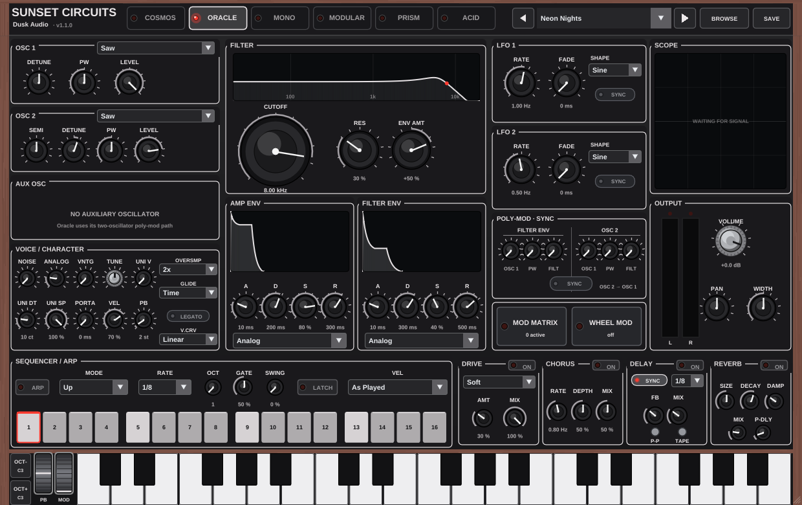
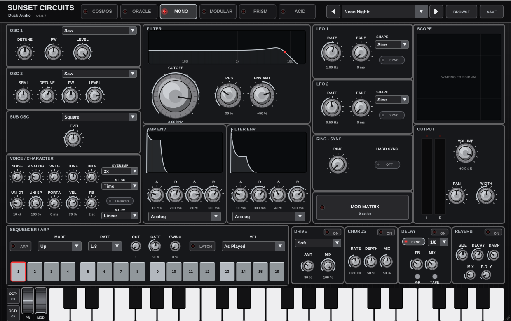
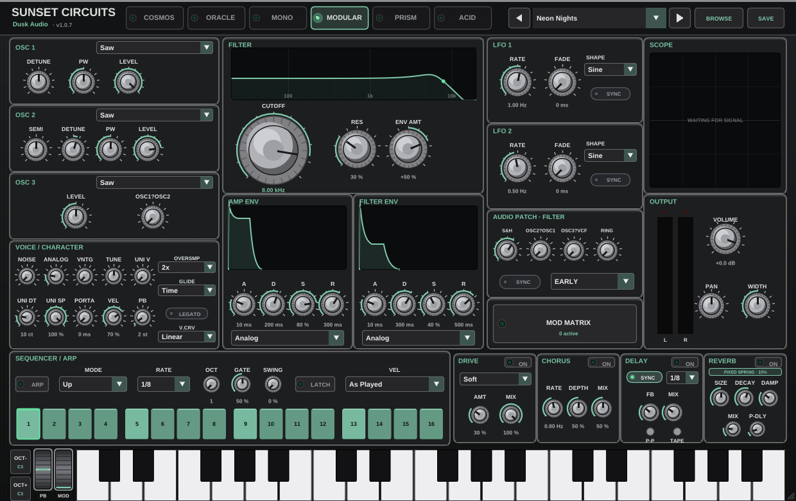
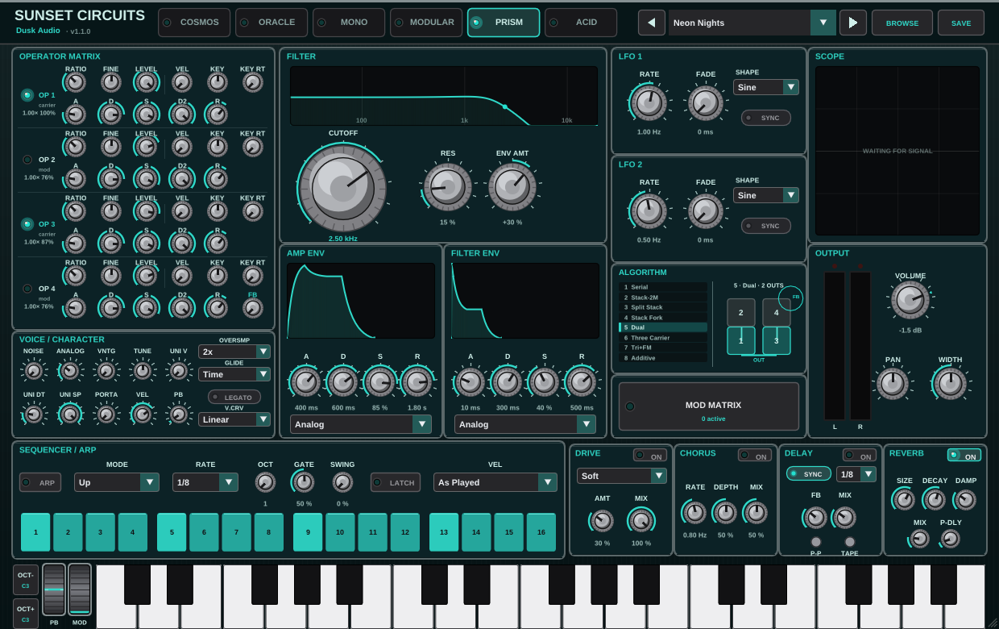
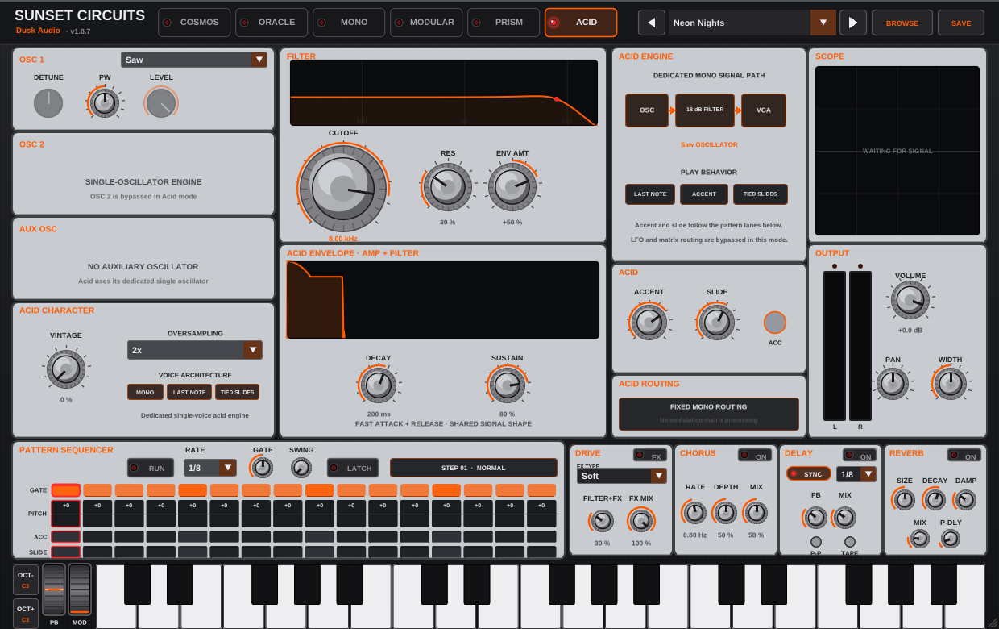
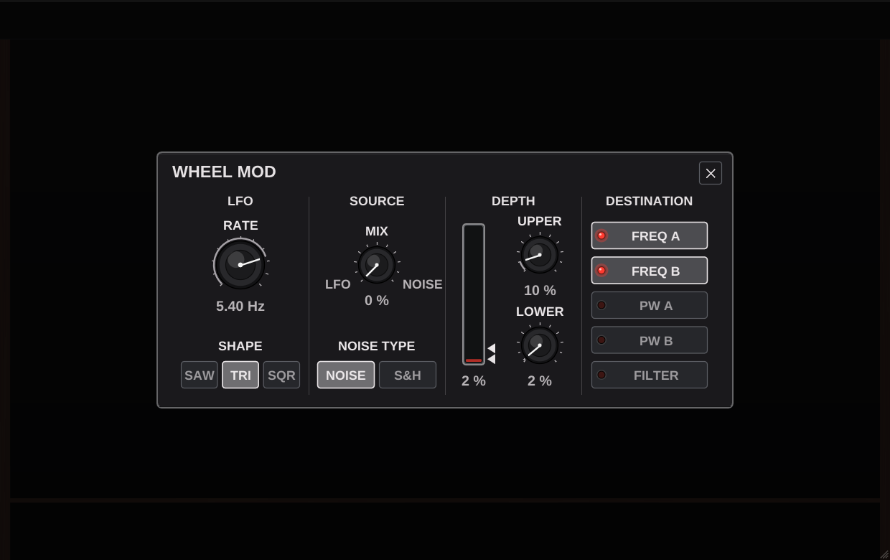
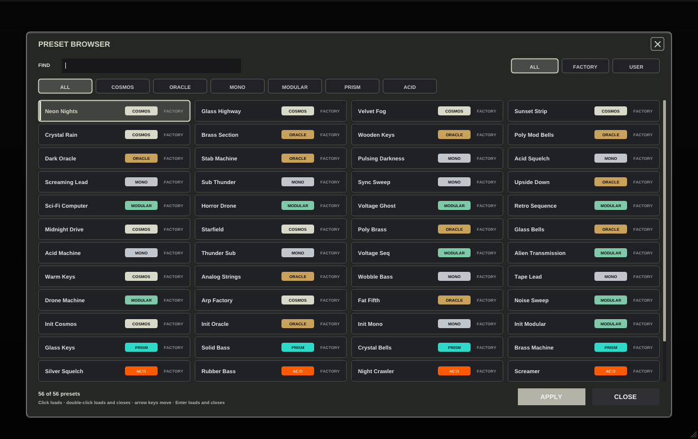

# Sunset Circuits

## Overview

Sunset Circuits is six vintage synthesizers in one instrument. A row of six backlit mode rockers across the top picks the engine, and each mode is a different classic circuit with its own voice architecture, its own signature controls, and its own panel color. Switching modes is a creative decision, not just a preset change; the whole personality of the instrument changes with it.

The six modes cover the ground that defined subtractive and FM synthesis:

- **Cosmos** is an early-80s Japanese six-voice poly built on digitally controlled oscillators, with a resonant low-pass filter and a built-in bucket-brigade chorus.
- **Oracle** is a late-70s American five-voice poly with two analog oscillators, a self-oscillating filter, and poly-modulation routing.
- **Mono** is an aggressive 70s monophonic voice with two oscillators plus a sub, a fat driven filter, ring modulation, and hard sync.
- **Modular** is a 70s semi-modular patchable voice with three oscillators, a transistor-ladder filter, sample and hold, and a spring reverb.
- **Prism** is a mid-80s four-operator FM digital engine with eight routing algorithms and per-operator envelopes.
- **Acid** is the bass box: one oscillator through a screaming diode-ladder filter, with accent and slide and a sixteen-step pitch pattern sequencer.

The same bone structure is present in every mode. The oscillator and mixer panels sit on the left, the filter and two envelopes fill the center, the two LFOs and the mod matrix are on the right, and the sequencer and effects run along the bottom with a playable keyboard beneath them. Because the layout never moves, you keep your bearings when you switch circuits; only the colors, the mode sub-panel, and a handful of mode-specific controls change.


Sunset Circuits ships with 57 factory presets spread across all six modes, plus a user preset library you build yourself. It is a full instrument, not an effect: insert it on an instrument track, feed it MIDI, and play.

## Getting Started

### Formats and installation

Sunset Circuits builds as VST3, CLAP, and LV2 on every platform, plus an Audio Unit on macOS. The binaries share the base name `sunset-circuits`.

**Linux**

```text
VST3: ~/.vst3/sunset-circuits.vst3
CLAP: ~/.clap/sunset-circuits.clap
LV2:  ~/.lv2/sunset-circuits.lv2
```

**Windows**

```text
VST3: C:\Program Files\Common Files\VST3\sunset-circuits.vst3
CLAP: C:\Program Files\Common Files\CLAP\sunset-circuits.clap
LV2:  C:\Program Files\Common Files\LV2\sunset-circuits.lv2
```

**macOS**

```text
VST3: ~/Library/Audio/Plug-Ins/VST3/sunset-circuits.vst3
CLAP: ~/Library/Audio/Plug-Ins/CLAP/sunset-circuits.clap
LV2:  ~/Library/Audio/Plug-Ins/LV2/sunset-circuits.lv2
AU:   ~/Library/Audio/Plug-Ins/Components/sunset-circuits.component
```

After installing, rescan plugins in your DAW. If the instrument does not appear, confirm the file landed in the folder above and that your host scans that folder.

### The six mode rockers

The six mode rockers at the top center are the most important control in the instrument. Click one to switch circuits. The panel color crossfades over about a quarter second, the mode sub-panel (the small panel on the right, below the LFOs) morphs to show that mode's signature controls, and a few controls in the standard panels appear or disappear depending on which mode is active. The mode is a normal automatable parameter, so you can switch circuits from the host if you want.

Switching modes is click-safe. The old circuit's voices fade out over 36 ms and the new circuit fades in over the same time, so a mode change under a held chord is a short dip rather than a click, and the delay and reverb tails ring on through it. The notes you are holding, on the keys or with the sustain pedal, carry over: the new circuit plays them as it comes up, so you can audition circuits under a held chord. A circuit with fewer voices than the notes you hold takes the most recent ones, so Mono plays the last key you pressed. The switch lands on an exact sample rather than waiting for the next buffer boundary, so it sounds the same at a 64-sample buffer and at 4096.

All six circuits play at Cosmos's level, so a mode change does not jump the volume. On the factory starting patch, a held note in any mode measures on average within 0.1 dB of Cosmos across C2, C3, C4 and C5, and within 2 dB on any one of those notes. Chords match within 0.2 dB, except on Modular, where they play about 2.4 dB quieter. The level match is applied after the effects, so it does not change how hard a patch drives the Drive effect. Delay and reverb tails still ringing from the old mode keep their level through the 36 ms fade, then settle to the new mode's level over about 40 ms, so switching from Cosmos to Oracle or Acid lowers a long tail by 5 to 6 dB. The same holds with every knob at its default, which is how a new instance starts: Oscillator 1 and 2 Level now default to 0.8 and 0.6, the values every factory sound starts from.

Loading a factory preset also sets the mode, because the mode is stored with the preset. If you switch modes by hand without loading a preset, the other parameters keep their current values, so the sound may not match what you expect from that circuit until you load a preset or dial it in.

### Playing

The full-width keyboard at the bottom is playable with the mouse and sends MIDI notes to the engine. It spans 21 white keys (three octaves). Notes arriving from your DAW light up on the keyboard as they play. For real performance, drive the instrument from a MIDI controller or a piano roll; the on-screen keyboard is for quick auditioning.

**Velocity comes from where you strike the key.** The click's vertical position inside the key maps to velocity from 30 at the top edge to 120 at the bottom: strike high on the key for soft, low on the key for hard. Each key measures against its own height, so black keys and white keys feel the same. Dragging along the keyboard glissandos, and the velocity is re-read on each new key, so a drag that wanders down the keys crescendos. The bottom of the range clears the Acid accent threshold (velocity above 100), so in Acid mode a hard strike accents the way it would on the hardware.

**The OCT- and OCT+ buttons** shift the played octave by twelve semitones per click, from a bottom key of C0 up to a bottom key of C6. The default is C3.

**The pitch and mod wheels** sit to the left of the keys. The pitch wheel is bipolar and springs back to center when you let go; the mod wheel latches where you leave it and also responds to the scroll wheel. Both grab absolutely, so clicking part-way up a wheel jumps it there. They are the on-screen stand-ins for the two controllers a hardware synth puts left of the keybed, and the only way to exercise the Pitch Bend and Mod Whl mod-matrix sources without external hardware.

**Glide and Legato.** Glide slides the pitch from one note to the next over the Glide time, or at a fixed rate with Glide Mode. With **Legato** on, notes that overlap tie: the new note takes over the one still held without a new attack, and glide happens only between overlapping notes, so a detached note lands straight on its pitch. That is the classic way to play Mono basses and leads. In the poly circuits a note ties only when it has to take over a voice that is still held, because a free voice is always used first. At full arpeggiator gate, Legato ties the arpeggiator's steps too, in every circuit: each step takes over the voice of the step before it (see the arpeggiator controls).

### Reading the panel

Most knobs carry a persistent value read-out underneath, so you can see what a patch is set to without touching anything. The read-outs need room to be legible: below about 72 percent of the design size (roughly 893 by 562 pixels) they are suppressed and a hover bubble takes over, showing the value of whatever knob the pointer is on. Make the window larger if you want the values on screen permanently. The Delay and Reverb panels work slightly differently: their knob labels swap to values while the pointer is inside the panel, and the panel latches into value mode while you are dragging a knob.

The window is freely resizable and keeps its aspect ratio; the whole panel scales to fit. The smallest size is half the design size, 620 by 390. The text is drawn from a font atlas baked when the plugin window opens, so if you move the window to a display with a different pixel density the text can look slightly soft until you close and reopen the plugin. Rebuilding the atlas live is planned for a future release.

### MIDI implementation

Sunset Circuits listens on **all MIDI channels** (omni), the usual convention for an instrument plugin, since your host already routes MIDI to the instrument per track.

| Message | What it does |
|---|---|
| Note On / Note Off | Plays the instrument. A Note On with velocity 0 counts as a Note Off. |
| Pitch Bend | Bends pitch over the range set by PB Range, and is available as a mod source. |
| CC 1 (Mod Wheel) | Feeds the Mod Whl mod source. |
| CC 64 (Sustain Pedal) | Holds notes after you release the keys, until you lift the pedal. |
| CC 121 (Reset All Controllers) | Resets the four performance controllers: lifts the sustain pedal, zeroes the mod wheel, zeroes channel aftertouch, and re-centers pitch bend. It does not touch any synth parameter, so your patch is unchanged. |
| Channel Pressure | Feeds the Aftertouch mod source for the whole instrument. |
| Poly Key Pressure | Feeds the Aftertouch mod source for that one note's voice only. Ignored while the arpeggiator is running, where the sounding notes are the arpeggiator's own; use channel pressure there. |
| Program Change | Recalls a factory preset by number (0 to 56); higher numbers are ignored. |
| CC 120 / CC 123 | All Sound Off / All Notes Off. Stops everything, including a latched arpeggiator and a running Acid pattern, and releases the pedal. |

The sustain pedal works in every mode. In Mono and Acid it holds the last note you played, and with the arpeggiator or the Acid sequencer running it holds the pattern's notes exactly as keeping the keys down would, so the pattern keeps playing until the pedal comes up. The difference from Arp Latch is that the pedal is momentary: latch holds until you switch it off, the pedal holds only while it is down.

CC 120 and CC 123 are a true panic. They clear the arpeggiator and Acid held-note sets as well as the sounding voices, so a latched pattern stops rather than carrying on with nothing to release it, and the pedal is lifted so the next note you play cannot be stranded by a pedal the panic left down.

One caveat applies to program changes in the LV2 version only. A preset recalled by a MIDI program change is applied to the sound immediately, but with the plugin window closed the host is not told which knobs moved, so your DAW may save the old values with the session. The VST3 and CLAP builds are unaffected, and so is LV2 with the window open. If you drive presets by MIDI in an LV2 host, open the plugin window once before saving.

## The Six Modes

### Cosmos: six-voice DCO poly

Cosmos uses a charcoal panel, red synth-section bars, blue performance-section bars, yellow/orange chorus switches, and a green display.

Cosmos is modeled on an early-80s Japanese polysynth with digitally controlled oscillators. It is six-voice polyphonic. The DCO combines saw, pulse, and an octave-down sub with fixed mixer levels: adding a waveform adds to the sound without turning the other sources down. The sub follows Oscillator 1 pitch modulation and detune. Cosmos uses white noise. The 24 dB per octave low-pass reaches self-oscillation near the top of the resonance control, paired with a separate high-pass control for thinning the low end.

The signature of Cosmos is the built-in bucket-brigade chorus. The mode sub-panel is titled **BBD CHORUS** and offers four settings, **OFF**, **I**, **II**, and **I+II**, which set the `Chorus Mode`. Chorus I sweeps at about 0.40 Hz; Chorus II is faster and slightly deeper at about 0.83 Hz. Each uses opposing left/right delay sweeps, so the chorus remains audible when summed to mono. I+II adds both for a denser sound. Fixed headroom ahead of the global effects accommodates the additive mixer and chorus. This chorus is separate from the global chorus in the effects section.

Mode-specific controls visible in Cosmos: the **Sub** oscillator (wave and level), the filter **HP** knob, the **Cross Mod** knob (oscillator 2 modulating oscillator 1 at audio rate), and the four chorus buttons.

### Oracle: five-voice poly with poly-mod

Oracle is modeled on a late-70s American five-voice polysynth with two true analog oscillators per voice and a self-oscillating low-pass filter. Where Cosmos is clean and stable, Oracle is characterful and alive. The filter reaches self-oscillation at high resonance, so it can sing on its own. Oracle uses white noise, at the level the instrument it is modeled on sets beside its own oscillators, and turning the noise up adds to the sound without turning the oscillators down.

Oracle's black panel has white outlines and labels, red lamps and a walnut frame. The six routing knobs in **POLY-MOD / SYNC** send the filter envelope or oscillator 2 to oscillator 1 pitch, oscillator 1 pulse width, or filter cutoff. Below them sit Cross Mod and Sync. The arrow under Sync reads OSC 2 -> OSC 1.



- **FEnv to OscA**: the filter envelope raises oscillator 1's pitch, by a fixed musical interval that is the same on every note: 0.339 semitones per percent of the knob, up to 33.9 semitones at full. For pitched attack transients and bell tones.
- **FEnv to PW**: the filter envelope narrows oscillator 1's pulse, by 2.3 percent of the cycle per percent of the knob, and can close it altogether (the pulse falls silent), so small settings already move a narrow pulse a lot. For moving attacks and animated pulse tones.
- **FEnv to Filter**: the filter envelope raises the cutoff on top of the filter's own envelope amount, by 0.143 octave per percent of the knob (14.3 octaves at full, more than the filter's range). For extra bite.
- **OscB to OscA**: oscillator 2 bends oscillator 1's pitch at audio rate, up to 7.1 semitones either way at full, for clangorous inharmonic timbres.
- **OscB to PW**: oscillator 2 swings oscillator 1's pulse width both ways, by 0.585 percent of the cycle per percent of the knob, and from about three quarters up it can close the pulse; for animated pulse textures.
- **OscB to Filter**: oscillator 2 moves the filter cutoff at audio rate, up to 3.1 octaves either way at full, for growling and metallic filter FM.
- **Sync**: oscillator 2 hard-syncs oscillator 1. Each time oscillator 2 starts a cycle it restarts oscillator 1, creating swept harmonic edges when their pitches differ. This is the reverse of Mono and Modular, as on the instrument Oracle is modeled on: oscillator 1 is the one Poly-Mod plays, and with Sync on, modulating its pitch (from the filter envelope, oscillator 2 or the mod matrix) sweeps its timbre while the note keeps oscillator 2's pitch.

**Cross Mod** in the Poly-Mod panel applies linear frequency modulation from oscillator 2 to oscillator 1. For the earlier bell voicings, the Cross Mod amounts were 50 percent on Poly Mod Bells and 60 percent on Glass Bells.

Mode-specific controls visible in Oracle: the six poly-mod routing knobs, **Cross Mod**, the **Sync** button, and the **WHEEL MOD** button next to **MOD MATRIX**, which opens Oracle's Wheel Mod section (see [Wheel Mod (Oracle)](#wheel-mod-oracle)). There is no sub oscillator or adjustable high-pass filter in this mode; the third panel on the left reads **AUX OSC** with a note that Oracle uses its two-oscillator poly-mod path instead.

### Mono: aggressive monophonic

Mono is modeled on a 70s Japanese monophonic synth voiced for aggression: two oscillators plus a sub, a fat driven filter, ring modulation, and hard sync. It is a single voice (one note at a time), which is exactly right for basses and leads that need weight and glide. Its noise is pink, and turning it up adds to the sound without turning the oscillators down.



Mode-specific controls visible in Mono: the **Sub** oscillator (wave and level), and the mode sub-panel's **RING / SYNC** section with the **Ring Mod** knob (ring modulation between oscillators 1 and 2) and the **Hard Sync** button (oscillator 2 hard-syncs to oscillator 1 for tearing, vocal-formant timbres).

### Modular: semi-modular

Modular is modeled on a 70s semi-modular synthesizer: three oscillators, a transistor-ladder filter, linear FM between oscillators, a sample and hold, and a real dispersive spring reverb. It is two-voice, so you can play the occasional dyad, but it is at its best on evolving drones, sci-fi effects, and sequences. Its noise is pink, and turning it up adds to the sound without turning the oscillators down.



Mode-specific controls visible in Modular: the third oscillator (**Osc 3** wave and level) and, beside it, the **Osc 1 to Osc 2** knob that sets the linear FM amount. The mode sub-panel is titled **AUDIO PATCH / FILTER** and carries the patch points as four knobs:

- **S&H**: the sample and hold clock rate in Hz, which feeds the S&H modulation source.
- **Osc 2 to Osc 1**: cross modulation depth between the first two oscillators.
- **Osc 3 to VCF**: how far oscillator 3 modulates the filter cutoff, for audio-rate filter FM.
- **Ring**: ring modulation depth.

Below them sit a **SYNC** button (oscillator 2 hard-syncs to oscillator 1) and an **EARLY / LATE** selector that picks which revision of the transistor ladder the filter models. The late revision deliberately stops opening at around 12 kHz, the way the later hardware did; the early revision stays open across the full range. When Modular is active the effects reverb panel reads **FIXED SPRING** with its send percentage, to indicate the spring tank is engaged for that mode.

### Prism: four-operator FM

Prism is a mid-80s four-operator FM digital engine. It is eight-voice polyphonic. Instead of oscillators and a filter shaping a rich waveform, FM builds timbre by having sine-wave operators modulate each other's phase. The result is the glassy electric pianos, chiming bells, punchy basses, and metallic brass that defined 80s digital synthesis.

When Prism is active, the left column re-skins into an **operator matrix**: four stacked operator strips replace the standard oscillator panels. Each strip has these controls:

- **Ratio**: the operator's frequency as a multiple of the played note. Dragging or turning the mouse wheel steps through 53 ratios in order: the classic FM ratios 0.25, 0.5, 0.75, 1, 1.5 and 2 to 16, and the ratio table of the four-operator hardware Prism is modeled on, which adds the inharmonic ratios 1.41, 1.57 and 1.73 times each whole ratio (0.71, 0.79 and 0.87 below 1), such as 2.83, 3.14 and 3.46 above 2. Each step takes 5 pixels of drag. Hold Shift for a continuous drag, or type a value; any ratio plays in tune.
- **Fine**: fine detune of the operator in cents, for slight beating and inharmonicity.
- **Level**: the operator's output. For a carrier this is volume; for a modulator this is modulation depth (FM brightness). It follows the output-level law of the instruments Prism is modeled on: each percent of the knob is about 0.75 dB, about 74 dB over the whole range, so most of the musical range sits in the upper half.
- **Vel**: how strongly note velocity affects that operator's level, so harder playing gets brighter.
- **Key Scale**: how the operator's level falls across the keyboard, for rolling a bright tine or edge off the top of the range. Turned to the left it takes level off toward the high keys, as on the hardware: about 6 dB at middle C at full scaling, doubling every octave up. Turned to the right it does the same toward the low keys.
- **A / D / S / R**: a full envelope per operator, so each partial can have its own attack and decay. As on the hardware, the attack rises quickly out of silence and eases into full level, and the decay and release fall at a steady rate in decibels; the decay stops at the sustain level. Sustain is in decibels too, about 3 dB per fifteenth of the knob, 45 dB over its range.
- **D2**: a second decay, as on the hardware. Once the decay reaches the sustain level, the operator keeps falling at this rate, 60 dB in the time shown, down to silence while the key is held, so a held FM piano or bell note can fade on its own. At the top of the knob, HOLD, the sustain level holds as before. It runs up to 86 seconds.
- **KEY RT**: rate scaling, 0 to 3. The operator's whole envelope (attack, decay, D2 and release) runs faster on higher keys and slower on lower ones, so high notes of a piano or bell die away sooner, as on the hardware. At 0 it tracks slightly, as the hardware does: about 1.2 times slower at C2 and below, as shown from C#2 to C4, about 1.2 times faster from C#4 to C6 and about 1.4 times faster from C#6 up. Each setting doubles the tracking, up to 3, which doubles the speed every octave. The times shown on the knobs are exact at middle C.

Operator 4 additionally carries the **Feedback** knob, which feeds the operator back into its own phase for growl and edge. It has seven steps, and as on the hardware it feeds back operator 4's actual output, so turning that operator's Level down or letting its envelope decay also softens the feedback. The top step gives a smooth, saw-like tone. The filter section stays in circuit in Prism, so you can still filter the FM tone if a preset opens the cutoff. In Prism it runs clean, without the drive the filters of the analog modes add.

The mode sub-panel is the **ALGORITHM** widget: a numbered list of the eight routings down the left, and a large diagram of the selected one filling the rest of the panel. Click a name to switch. Hovering a name shows its number and title as a tooltip. See the FM guide below for what each algorithm does.



### Acid: bass box and pattern sequencer

Acid is the bass box: one oscillator (saw or square) through a three-pole diode-ladder low-pass filter that screams near self-oscillation, with an accent circuit and note-to-note slide, driven by a sixteen-step pattern sequencer. It is monophonic. This is the sound of a thousand acid basslines.

Acid keeps the dark chassis and marks itself with an orange accent, but its left column is rearranged around the dedicated engine: **OSC 2** reads "single-oscillator engine", **AUX OSC** reads "no auxiliary oscillator", and an **ACID CHARACTER** panel takes their place with the Vintage knob, the oversampling selector, and the voice architecture buttons. On the right, **ACID ENGINE** draws the mono signal path of oscillator into an 18 dB filter into the VCA, and **ACID ROUTING** states that the modulation matrix is not in circuit here. The oscillator waveform combo defaults to saw and is intended to be saw or square, though the other waves remain available.



**The shared-knob mapping in Acid.** Rather than adding a wall of new controls, Acid re-purposes the standard panels you already know:

- **Filter Cutoff** sets the base brightness of the line, the knob you sweep for the classic wah.
- **Filter Resonance** is the squelch. Push it toward the top (around 0.8 and up) for the resonant whistle; near 0.95 the filter is at the edge of self-oscillation, which is the scream.
- **Filter Env Amt** is how far each note's envelope opens the filter, the pluck of the sound.
- **Amp Decay** (with Amp Sustain at zero) sets how quickly each step decays, from short and staccato to long and connected.
- The two Acid globals live in the mode sub-panel: **Acid Accent** sets how much an accented step boosts level, resonance, and envelope depth (the "wow" that makes accents jump out), and **Acid Slide** sets the glide time for slid steps.

The pattern itself lives in the sequencer, which expands to four lanes in Acid mode. See the sequencer chapter below for the gate, pitch, accent, and slide lanes.

### Per-mode visibility summary

| Control | Cosmos | Oracle | Mono | Modular | Prism | Acid |
|---|---|---|---|---|---|---|
| Standard OSC 1 / OSC 2 panels | yes | yes | yes | yes | hidden (operator matrix) | yes (saw/square) |
| Osc 3 wave and level | no | no | no | yes | no | no |
| Sub wave and level | yes | no | yes | no | no | no |
| Filter HP | yes | no | no | no | no | no |
| Cross Mod | yes | yes | no | no | no | no |
| Poly-mod (6 knobs) | no | yes | no | no | no | no |
| Ring Mod | no | no | yes | yes | no | no |
| Hard Sync | no | yes | yes | yes | no | no |
| FM Amount | no | no | no | yes | no | no |
| S&H rate | no | no | no | yes | no | no |
| Ladder revision (Early / Late) | no | no | no | yes | no | no |
| Chorus I / II / I+II | yes | no | no | no | no | no |
| Operator strips and algorithm | no | no | no | no | yes | no |
| Acid globals and 4 sequencer lanes | no | no | no | no | no | yes |

Controls that are irrelevant to a mode are hidden, not greyed out. A hidden widget only removes the on-screen control; the underlying parameter always stays in the host's parameter list, so automation lanes never break.

## FM Guide (Prism)

FM synthesis in Prism uses four sine-wave **operators**. An operator that reaches the output is a **carrier** (you hear it). An operator that instead modulates another operator's phase is a **modulator** (you hear its effect on the carrier's timbre, not the operator itself). The **algorithm** is the wiring diagram that decides which operators are carriers and which modulate which.

The two levers that shape an FM tone are operator **Level** and operator **Ratio**. Raising a modulator's Level adds harmonics and makes the carrier brighter (this is the FM equivalent of opening a filter). The modulator's Ratio decides where those harmonics land: integer ratios (1, 2, 3) give harmonic, pitched tones, while non-integer ratios (2.76, 5.4) give inharmonic, bell-like and metallic tones. Operator 4's **Feedback** turns operator 4 into a controllable noise and edge source, from a touch of grit to a full growl.

### The eight algorithms

Operators are numbered 1 to 4. In the table, `a to b` means operator `a` modulates operator `b`, and the carriers are the operators you hear. Operator 4 is the feedback operator in every algorithm.

| # | Name | Routing | Carriers | Character |
|---|---|---|---|---|
| 1 | Serial | 4 to 3, 3 to 2, 2 to 1 | 1 | One long modulation stack into a single carrier. The brightest and most metallic algorithm; the classic bright bass and lead voice. |
| 2 | Stack-2M | 4 to 2, 3 to 2, 2 to 1 | 1 | Two modulators feed one, which feeds the carrier. Rich and vocal, good for reeds and complex leads. |
| 3 | Split Stack | 3 to 2, 2 to 1, 4 to 1 | 1 | A two-operator stack and a second modulator meet at one carrier. Layered and harmonically dense. |
| 4 | Stack Fork | 4 to 3, 3 to 1, 2 to 1 | 1 | A serial branch and a direct modulator meet at one carrier. Bright and responsive without the full serial chain. |
| 5 | Dual | 2 to 1, 4 to 3 | 1, 3 | Two independent two-operator stacks. Layer a body tone against a tine or edge; the workhorse e-piano algorithm. |
| 6 | Three Carrier | 4 to 1, 4 to 2, 4 to 3 | 1, 2, 3 | One modulator colors three parallel carriers. Broad, layered tones retain a strong pitched center. |
| 7 | Tri+FM | 4 to 3 | 1, 2, 3 | One modulated tone plus two clean carriers. Mostly additive with a single FM color; organ-like with an edge. |
| 8 | Additive | (none) | 1, 2, 3, 4 | Four parallel carriers, no modulation. Pure additive synthesis; drawbar-organ and formant tones. |

```text
  Alg 1 (serial)      Alg 4 (stack fork)     Alg 5 (dual stack)     Alg 8 (additive)
     [4]                  [4]   [2]              [2]   [4]            [1][2][3][4]
      |                    |     |                |     |              |  |  |  |
     [3]                  [3]   /                [1]   [3]             ============
      |                     \  /                  |     |               (output bus)
     [2]                    [1]                 ==== output bus ====
      |                  ==== output ====
     [1]
   ==== output ====
```

The algorithm diagram widget in the Prism sub-panel draws the active routing live, brightens the carriers, and shows the feedback loop on operator 4 with a thickness that tracks the Feedback knob. Click any name in the list beside it to switch algorithms.

## Sequencer and Arpeggiator

The sequencer strip along the bottom is an arpeggiator and step sequencer shared by all six modes. In modes Cosmos through Prism it behaves as a classic arpeggiator with sixteen step-mute cells; in Acid it expands into a four-lane pattern sequencer.

### Arpeggiator controls

- **Arp On**: enable the arpeggiator or step sequencer. Switch it on while you hold keys and the pattern starts on them; switch it off and the keys you are still holding keep sounding as a chord (in Mono and Acid, the last key you pressed). Nothing has to be pressed again.
- **Arp Mode**: the note order the arpeggiator plays: Up, Down, Up/Down, Down/Up, Random, Order (as played), or Chord. Chord is a known limitation in this release: it is selectable and stable, but it currently steps one note at a time exactly as Up does rather than striking every held note on each step. Use a held chord with the arpeggiator off if you want block chords.
- **Arp Octave**: how many octaves the arpeggio spans, 1 to 4.
- **Arp Rate**: the step length as a note division, from 1/1 down to 1/32, including dotted (1/8. and so on) and triplet (1/8T and so on) divisions.
- **Arp Gate**: the length of each step relative to its slot, from staccato to fully connected. At full gate with Legato on, the steps tie: each one takes over the last without a new attack, and glides into it when Glide is up. A repeated note simply holds.
- **Arp Swing**: delays the off-beat steps for a swung feel while keeping the downbeats on the grid.
- **Arp Latch**: holds the pattern after you release the keys, so it keeps playing hands-free.
- **Arp Vel Mode**: where each step's velocity comes from: As Played, Fixed, or Accent.
- **Arp Fixed Vel**: the velocity used when the mode is Fixed.
- **Arp Accent Pattern**: the accent shape, which appears under the velocity selector once the velocity mode is Accent. Downbeat accents every fourth step, Every Other alternates loud and soft, Ramp Up climbs from soft to loud and Ramp Down falls from loud to soft. The shape is laid over the sixteen-cell step grid rather than over the held notes, so it stays put no matter how many keys you hold: Downbeat accents cells 1, 5, 9 and 13, and the two ramps run over eight cells and repeat twice across the row. The control has no effect in the other two velocity modes, which is why it is only shown in Accent. In Acid mode the arpeggiator (and with it this control) is not used at all; the pattern sequencer has its own per-step accent lane, though the parameter itself remains visible to the host.
- **Step cells**: the sixteen cells turn individual steps on or off (step-mutes) in every mode.

### Host sync behavior

The arpeggiator always follows the host tempo. The step length is computed from the host BPM and the Arp Rate division, so at 128 BPM a 1/8 step is the correct length automatically, whether or not the transport is running. Auditioning with the transport stopped still steps at the host tempo.

When the DAW transport is playing and reports a valid song position, the arpeggiator phase-locks to the absolute host beat grid. Steps land on the beat rather than on wherever you happened to press the key, and the pattern re-syncs cleanly on a loop wrap so it never drifts over a long section. This is a quantized start: the first step of a held chord snaps to the grid.

When the transport is stopped, the arpeggiator free-runs from the moment you play, still at the host tempo, so you can practice or sound-design without pressing play. Switching between the locked and free states cleanly releases any sounding note so a transport change can never leave a note stuck on.

### Acid pattern lanes

In Acid mode the sequencer section retitles itself **PATTERN SEQUENCER** and expands into four labelled lanes that together define the sixteen-step pattern. You hold a single root note and the pattern transposes with it.

- **GATE** (top): the sixteen on/off cells, the same step-mutes used in the other modes. A muted step is a rest.
- **PITCH**: sixteen vertical drag columns, one per step, setting each step's pitch offset from -24 to +24 semitones relative to the held root. Drag a column up or down; the bar fills from the center zero line. This is where the melodic shape of the line lives.
- **ACC**: sixteen cells. An accented step jumps out using the Acid Accent amount (louder, more resonant, more envelope).
- **SLIDE** (bottom): sixteen cells. A slid step glides the pitch into that step over the Acid Slide time, for the legato portamento that defines the acid sound.

The live step position highlights the current column across all four lanes as the pattern plays.

## LFOs

There are two LFOs, and every voice owns its own pair, so they are per-note rather than global. Each has a **Shape** (Sine, Triangle, Square, Sample and Hold, or Random Smooth), a **Rate** from 0.01 to 50 Hz, a **Fade In** from 0 to 5 seconds for modulation that arrives after the attack, and a **Sync** switch.

Nothing is hardwired. An LFO does not reach pitch, filter, or amplitude until you route it in the mod matrix, which is also true of the mod wheel. There is no built-in vibrato path to work around. The one exception is Oracle's Wheel Mod section, which has its own single LFO and its own wheel path (see [Wheel Mod (Oracle)](#wheel-mod-oracle)); it is off until you switch one of its destinations on.

### LFO sync

**Sync locks the LFO's phase to the host's song position, not just its speed.** With the transport playing and a valid song position, the LFO's phase is computed from the bar position, so it lands the same way on every pass, re-anchors after a seek or a loop wrap, and cannot drift against the bar over a long section. This is the part that a plain rate multiplier never gives you: rate scaling alone gets the average speed right but leaves the phase wherever the last note happened to start it.

Under sync the cycle length comes from the Rate knob rather than from a separate division list. Rate 2.0 is one cycle per quarter note, 1.0 is one cycle per half note, 4.0 is one cycle per eighth note; the relationship is tempo-invariant, so the LFO tracks a tempo change automatically. There is no note-division selector on the LFOs (the arpeggiator and the delay have those).

Two behaviors are worth knowing:

- **A note-on does not retrigger a locked LFO.** That is the point of locking: every voice you play joins the same running phase, so a chord modulates in step instead of each note starting its own sweep. Without sync, a note-on does reset the LFO to the start of its cycle. The fade-in restarts either way.
- **Sync free-runs when the transport is stopped.** You still get a tempo-correct rate for auditioning; the phase lock engages when you press play. The lock is eased in over up to a quarter second rather than snapped, so engaging the transport does not jump a slow modulation.

While phase-locked, **LFO1 Rate / LFO2 Rate modulation routes do not change the cycle length**; the Rate knob and host grid set it. Those routes affect speed again when the transport stops or Sync is off. For Random Smooth, rate modulation still changes the smoothing speed while locked.

## Wheel Mod (Oracle)

Oracle has the modulation section of the instrument it is modeled on: one LFO and one noise source, mixed, scaled by the mod wheel, and switched to five destinations. Open it with the **WHEEL MOD** button next to **MOD MATRIX** on the right of the Oracle panel. The button's lamp lights, and it shows how many destinations are on, whenever the section is doing something.



**It is one source for the whole instrument.** Every voice hears the same LFO and the same noise at the same moment, so a chord wobbles together, and the LFO runs freely: playing a note never restarts it. This is the difference from the two LFOs in the LFOs section, which every voice owns a copy of.

**Wheel Mod starts off.** Older projects and presets load with all five destinations off. Turn on a destination to hear the section in Oracle. Switching to another mode keeps the settings for when you return to Oracle.

The panel reads left to right, in signal order.

| Column | Control | What it does |
|---|---|---|
| LFO | **Rate** | 0.03 Hz (one cycle every 33 seconds) to 26.2 Hz, on an exponential knob: the middle of its travel is about 0.89 Hz. |
| LFO | **Shape**: **Saw**, **Tri**, **Sqr** | Switch on any combination. Saw rises and drops, and only ever pushes up; Square jumps between rest and up; Triangle swings both ways. Combinations are not a simple sum, they follow the instrument: Saw with Square, for example, makes a sawtooth at twice the rate. With no shape on, the LFO is silent. |
| Source | **Mix** | From the LFO alone (left) to the noise alone (right), a straight crossfade. |
| Source | **Noise type**: **Noise**, **S&H** | Noise is a random wobble (about 71 cents of pitch deviation at full depth, most of its movement below about 150 Hz, and it dips further down than it rises). S&H replaces it with random steps, one new value at the start of every LFO cycle, anywhere up to 8 semitones up or down at full depth. |
| Depth | **Upper**, **Lower** | The depth with the mod wheel all the way up, and all the way down. The wheel moves the depth in a straight line between them. Set Lower above zero for modulation that is there without touching the wheel; set Lower above Upper and the wheel turns the modulation down instead. The rail shows both limits and, filled in, the depth the wheel is giving now. |
| Destination | **Freq A**, **Freq B**, **PW A**, **PW B**, **Filter** | Where the modulation goes: oscillator 1 or 2 pitch, oscillator 1 or 2 pulse width, the filter cutoff. Any combination. |

How far each destination moves, with the mod wheel and Upper at full:

- **Pitch**: the sawtooth sweeps up 11.75 semitones, the square jumps up 8 semitones, the triangle swings about 5.9 semitones each way, centered slightly above the note. The depth follows the wheel in a straight line, about 9.3 cents per step of a 128-step wheel.
- **Pulse width**: the square widens the pulse by 80 percent of the cycle. Past either end of its range the pulse closes and falls silent, as on the instrument, so this route can gate a pulse wave in time with the LFO.
- **Filter**: the square opens the cutoff by about 8.8 octaves, so even a small depth is a large sweep.

**Mod-wheel vibrato:** Triangle on, Mix all the way to LFO, Rate around 5 Hz, Freq A and Freq B on, Upper around 10 percent and Lower at 0. At full wheel the triangle then bends pitch by about 0.6 semitone either side of the note. Raise Lower slightly for a little vibrato with the wheel at rest.

Switching a destination on or off fades it over 5 ms, and the wheel and the Mix knob glide like the other smoothed controls, so none of them clicks. The Shape and Noise type switches change the modulation at once, as the panel switches do on the instrument.

The mod wheel is still a source in the mod matrix as well, and the Upper and Lower limits do not affect it there. The Wheel Mod section is not tempo-synced.

## Mod Matrix

The mod matrix is an eight-slot modulation router, opened from the **MOD MATRIX** bar on the right (the bar shows how many slots are active; in Oracle it shares the bar with the **WHEEL MOD** button). Each slot connects one source to one destination with a bipolar amount, so you can invert a modulation by using a negative amount. All eight slots are always available in every mode.

**Sources**

| Source | What it is |
|---|---|
| None | Slot inactive. |
| LFO 1 / LFO 2 | The two low-frequency oscillators. |
| Filt Env | The filter envelope. |
| Mod Whl | The MIDI modulation wheel. |
| Aftertouch | Key pressure. Channel pressure moves every voice; polyphonic key pressure moves only the voice playing that note. |
| Velocity | Note-on velocity. |
| Key Track | Note pitch across the keyboard. |
| Random | A new random value per note. |
| Pitch Bend | The pitch-bend wheel (in addition to its normal pitch effect). |
| S&H | The sample-and-hold value. |

**Destinations**

| Destination | What it modulates |
|---|---|
| None | Slot inactive. |
| Osc1 Pitch / Osc2 Pitch | Oscillator 1 or 2 frequency. |
| Osc1 PW / Osc2 PW | Oscillator 1 or 2 pulse width. |
| Cutoff | Filter cutoff frequency. |
| Reso | Filter resonance. |
| Amp | Voice amplitude. |
| Pan | Stereo position. |
| LFO1 Rate / LFO2 Rate | The speed of LFO 1 or 2. |
| FX Mix | The wet/dry balance of the effects. |
| Uni Det | The unison detune spread. |
| LFO1 Depth / LFO2 Depth | How much of LFO 1 or 2 reaches every slot that uses it. While any slot targets an LFO's depth, that LFO is scaled by the sum of those slots (source times amount), held between 0 and 100 %, so a depth slot at 0 % holds the LFO at zero; with none, the LFO runs at full depth. Routing one LFO to the other's depth uses its unscaled output. |

A classic starting patch is LFO 1 to Cutoff for a filter wobble, or Key Track to Cutoff so the filter opens as you play higher. Aftertouch to LFO1 Rate gives expressive vibrato that speeds up under pressure.

**Vibrato from the mod wheel.** Route LFO 1 to Osc1 Pitch at a small amount such as +20 % and, in a second slot, LFO 1 to Osc2 Pitch, then route Mod Whl to LFO1 Depth at +100 %. With the wheel down there is no vibrato, and pushing it up brings it in, up to the depth the LFO slots set. Osc1 Pitch moves the whole voice in Cosmos and Prism and Oscillator 1 in the other modes; Osc2 Pitch moves Oscillator 2 in Oracle, Mono and Modular. Neither moves the Mono sub oscillator or Modular's Osc 3, which stay at the played pitch. With Sync on, the note follows the master oscillator (oscillator 2 in Oracle, oscillator 1 in Mono and Modular), so put vibrato on the master; on the synced oscillator alone the same route sweeps the timbre instead.

In Acid mode the mod matrix is not in circuit, so the mod wheel and the depth destinations do nothing there.

**Compatibility of the depth destinations.** Saved projects and presets keep their destinations in every format. A project or preset that uses LFO1 Depth or LFO2 Depth, opened in version 1.0.10 or earlier, plays those slots as Uni Det, and the mod matrix shows Uni Det. Destination automation is different: the two depth destinations grew each slot's destination from 13 to 15 choices, and a host that stores an automation lane as a position between the first and last value, as VST3 hosts do, now plays a different destination for most values of a lane recorded before:

| Recorded | Now plays |
|---|---|
| None, Osc1 Pitch, Osc2 Pitch | unchanged |
| Osc1 PW | Osc2 PW |
| Osc2 PW | Cutoff |
| Cutoff | Reso |
| Reso | Amp |
| Amp | Pan |
| Pan | LFO1 Rate |
| LFO1 Rate | FX Mix |
| LFO2 Rate | Uni Det |
| FX Mix | LFO1 Depth |
| Uni Det | LFO2 Depth |

Re-record such lanes. Automation in other hosts and formats has not been tested; after updating, check any lanes on the eight Mod Dest parameters.

## Presets

### Opening an older project

A project recalls its program first, then restores the knob values you saved. A re-voiced factory preset therefore plays with the old settings in an existing project. Select the preset again to load the adjusted factory version. Save a copy first if you want to keep your edits.

With older saved values, Poly Brass measured 1.09 dB louder and sounded brighter, Brass Section gained 0.44 dB, Poly Mod Bells lost its metallic attack, and Noise Sweep gained 2.52 dB. These changes come from the revised Oracle Poly-Mod routes and bell settings, and from removing the oscillator level drop when Mono or Modular noise is mixed in. Both modes still use pink noise.

For your own Oracle sync patches, put vibrato on oscillator 2 to move the note or on oscillator 1 to sweep the tone. Oscillator 1 has no independent semitone control, so recreating an older sync patch can take retuning by ear. The envelope now raises oscillator 1 by the same interval across the keyboard, and narrows its pulse. Oracle's mixer now uses white noise and lets the oscillators keep their level as you add it. Its filter and output also pass more low bass, which can raise peaks. If a project runs at 88.2 or 96 kHz, check its Oversampling setting too. At these rates 1x and 2x now both run at the session rate and 4x runs at twice it.

Your own patches in Oracle, Mono, Modular, Prism and Acid play quieter than before, by 5.1, 4.9, 3.8, 3.7 and 5.8 dB, because those circuits now play at Cosmos's level (see The six mode rockers). Raise Master Volume by the same amount to get the old level back. Its range now reaches +18 dB, up from +6 dB, so that the quietest factory sounds can reach the bank's level. Cosmos patches are unchanged. A project saved with a factory preset in one of those modes restores the preset's old Master Volume, so it also plays quieter. Select the preset again to load its new level.

In your own Prism patches, an operator Level below full is now quieter as a carrier and modulates less as a modulator, because the knob follows the steeper level law described under Prism, and a modulator at full level reaches half its old depth. A carrier at 50 percent plays about 13 dB lower than before, and a modulator at 50 percent gives about a ninth of its old depth. Raise those Levels to get the old balance back. Prism's Feedback steps are also weaker than before, by 6 to 11 dB at full operator level, and now follow operator 4's level and envelope. Key Scale now only lowers the level, toward the high keys or the low keys, so a patch that used it to raise one side of the keyboard sounds different there. Operator attacks now rise quickly out of silence, so a slow attack swells in sooner; lengthen it by about 30 percent for the old feel. An operator Sustain below full now sits lower, because the knob is in decibels: 50 percent was -6 dB and is now about -23 dB.

### The preset menu and the browser

The top bar carries the preset controls: previous and next arrows around the preset name, a **BROWSE** button, and a **SAVE** button. The name itself is a drop-down menu that shows the whole library at once, one column per mode. Presets by a contributing artist close their mode's column under the artist's name: ZULU MATRIX under Oracle, Modular and Prism. Your own presets come last, under USER. The arrows step through the presets in the menu's order, column by column, and wrap around at the ends.

The drop-down shows names only. The browser is the library you read. **BROWSE** opens a full-window preset browser built for finding a patch rather than scanning for it:

- **Search.** The FIND field is focused the moment the browser opens, so you can just start typing. Matching is case-insensitive on any part of the name or the author.
- **Mode chips.** Seven chips (ALL plus the six mode names) narrow the list to one circuit.
- **Bank chips.** ALL, FACTORY, ARTISTS or USER. ARTISTS shows the presets made by contributing artists, each with its author under the name; USER shows only your own patches. Each cell is also tagged with its bank and its mode.
- **Keyboard.** Up and Down move a whole row and keep working while you are typing in the search field; Left and Right move one preset when no field has focus. Enter loads the highlighted preset and closes the browser.
- **Esc happens in two stages.** The first press clears a typed search; only once the search is empty does a press close the browser. This means Esc never throws away your place in the list by accident.
- **Mouse.** A single click loads the preset and leaves the browser open, so you can audition down a list while the panel re-skins around you. A double click (or APPLY) loads and closes. The close button in the title bar, the CLOSE button, and a click outside all close the browser without loading.

Hovering a cell shows the preset's name, mode and bank, and the author of an artist preset.

The footer shows how many presets the current filters match. The browser reads the preset library as it was last scanned; see the note on rescanning below.



### The user preset library

Beyond the 57 factory presets, Sunset Circuits keeps a personal preset library you build yourself, stored as files on disk independent of any DAW session, so your patches follow you between projects and hosts. The library is not saved into the host session; it lives in your own preset folder and is the same library in every project and every DAW.

### Saving a preset

Click the **SAVE** button in the top bar, to the right of BROWSE. A name-entry box appears; type a name and confirm (Enter commits, Esc closes). The current state of all parameters is written to a file, and the new preset appears in the preset menu under USER, after the factory presets.

If a preset with that name already exists, the box says so before you commit, and SAVE turns into an OVERWRITE and CANCEL pair so the overwrite is always a second, deliberate click. When the patch you are currently on is a user preset, the same box offers DELETE, which likewise asks for confirmation before it removes the file.

Loading a user preset works exactly like a factory preset: pick it from the menu, find it in the browser, or step to it with the previous and next arrows, and every parameter (including the mode) is restored. The arrows reach your presets after the last factory column and wrap around at the ends.

The preset folder is scanned when the plugin opens and after each save or delete, not on every menu open. If you add or remove `.scpreset` files by hand while the plugin is running, reopen the plugin to see the change.

### File location

User presets are plain files in a per-user application-data folder:

```text
Linux:   ~/.config/DuskAudio/SunsetCircuits/presets/
macOS:   ~/Library/Application Support/DuskAudio/SunsetCircuits/presets/
Windows: %APPDATA%\DuskAudio\SunsetCircuits\presets\
```

On Linux, if `XDG_CONFIG_HOME` is set it is used in place of `~/.config`. Each preset is one file named after the preset with the extension `.scpreset`.

### The .scpreset format

A `.scpreset` file is versioned plain text: a header line, a `name=` line, and one `symbol=value` line per parameter. It is human-readable and safe to back up, copy between machines, or share. Because it is plain text, you can inspect or hand-edit a patch if you want, though the plugin is the intended way to create them.

Loading is deliberately forgiving in one direction and strict in the other. Any parameter the file does not mention keeps its factory default, and any symbol the plugin does not recognize is skipped, so presets stay forward-compatible as the instrument grows. Values are clamped to each parameter's legal range, and a value that is not a finite number is rejected. A file whose header is missing or carries an unknown format version is rejected outright rather than loaded incorrectly. The library loads up to 512 presets in alphabetical order.

## Effects

Every mode runs through the same effects chain at the bottom right: Drive, Chorus, Delay, and Reverb, each with its own enable button. The Cosmos mode additionally has its own built-in vintage chorus, separate from the effects chorus.

### Drive

A saturation stage with three characters selected by **Drive Type**: **Soft** (gentle tube-like warmth), **Hard** (aggressive clipping), and **Tube** (asymmetric tube drive). **Drive Amount** sets how hard it pushes and **Drive Mix** blends the driven signal against the clean one. Use it for grit on basses and leads, or a light Soft setting to thicken pads.

### Chorus

A standard stereo chorus with **Rate**, **Depth**, and **Mix**. This is the global chorus available in every mode. It widens and animates any sound.

### Vintage chorus (Cosmos)

Cosmos has its own bucket-brigade chorus built into the circuit, controlled by the three **I / II / I+II** buttons in the mode sub-panel rather than by the effects Chorus. Its stereo delay sweeps and filtered wet paths are calibrated against reference captures. You can run it alongside the effects chorus, but usually one or the other is plenty.

### Delay

A stereo delay with **Feedback** and **Mix**, plus **Ping-Pong** and **Tape** options. Ping-Pong bounces the echoes across the stereo field; Tape adds tape-style warmth and saturation to the repeats. The delay can run free or synced:

- **Free**: the **Delay Time** knob sets the delay in milliseconds, up to 2000 ms.
- **Synced** (Delay Sync on): the **Delay Division** knob sets the delay as a note division locked to the host tempo.

The delay buffer holds 2 seconds. In synced mode at a slow tempo, a long division can ask for more than 2 seconds (for example a dotted half note below about 90 BPM); the delay is clamped to the 2-second buffer, so at very slow tempi the longest divisions stop tracking the tempo and hold at 2 seconds. Free mode is already capped at the 2000 ms knob maximum.

### Reverb

An algorithmic reverb with **Size** (0 to 1), **Decay** (0.1 to 20 seconds), **Damping**, **Pre-Delay** (up to 200 ms), and **Mix**. It is the same reverb in all six modes.

In **Modular** mode a real dispersive **spring** tank is switched in after it, at a fixed light mix, matching the spring of the semi-modular hardware; the panel shows SPRING to indicate this. Note that the spring is added to the chain rather than replacing the reverb, so in Modular you have both: the main reverb still responds to its own controls, and the spring sits behind it. The spring gives the boingy, dispersive character that a digital reverb cannot, and it is part of what makes Modular sound like a patchable vintage instrument. If you want the spring alone in Modular, turn the main reverb's enable off.

## Performance Notes

### Oversampling

The **Oversampling** control sets the internal processing rate: **1x**, **2x**, or **4x** stand for about 48, 96 and 192 kHz inside. In a 44.1 or 48 kHz session that means running the voices at one, two or four times the session rate. A session at 88.2 or 96 kHz is already at the 2x rate, so there 1x and 2x both run the voices at the session rate and 4x at twice it; at 176.4 or 192 kHz all three run at the session rate. Higher settings reject aliasing in the oscillators, the filter, and the FM operators at the cost of more CPU. The voices render at the internal rate; the effects run at the host rate.

- **1x**: lowest CPU, most aliasing on bright and high-pitched sounds. Fine for pads and bass.
- **2x**: the default and the recommended everyday setting. A good balance of clean high end and reasonable CPU.
- **4x**: the cleanest high end, for exposed leads, bright FM tones, and high notes where aliasing would be audible. Use it when you can afford the CPU.

The three new factory presets, Oracle Trumpet, Modular English Horn and Prism Talking Keys, keep the 4x setting they were made with. Prism Talking Keys was originally called Prism Talking Clav. The other 54 presets load at 2x.

The factor changes how clean the high end is and what it costs, not how a patch moves. The slow random pitch wander that the **Analog** control adds to each voice runs on its own clock, so a patch drifts at the same speed and depth at 1x, 2x and 4x and at every session sample rate.

Oracle's mixer noise works the same way: its level and its color are the same at every factor and every session sample rate.

A hard-sync restart falls where the master oscillator wraps within a sample. On a steady Oracle C7 (MIDI 96, three octaves above middle C) at 2x and 48 kHz, the strongest unwanted tone measured between -109.0 and -91.7 dBc across five waveforms. Vibrato moves the harmonics, so it calls for a different measurement. With the wheel up, Oracle Trumpet's energy outside the moving harmonics measured -66.6 dB at C6, -69.2 dB at G6 and -71.0 dB at C7.

Cosmos, Oracle, Mono and Modular smooth oscillator edges with a minimum-phase step at lower internal rates. Oracle, Mono and Modular also filter the oscillator mix before it reaches the voice filter. This pre-filter uses four poles at 18 kHz from an internal rate of 88.2 kHz and two poles at 20 kHz from 176.4 kHz. The highest harmonics of Oracle's oscillator 2 and Modular's oscillator 3 are also filtered on their routes to cutoff.

### Reported latency

The filter that brings the oversampled voices back to the host rate delays them slightly, by an amount that depends on the oversampling factor. The plugin pads the shorter paths so the delay is the same at every factor, and reports it to the host so plugin delay compensation keeps everything aligned:

| Oversampling | Reported latency |
|---|---|
| 1x, 2x and 4x | 13 samples |

These are host samples and are independent of the sample rate: 13 samples is 0.27 ms at 48 kHz. Because the latency never changes, switching oversampling does not make your DAW restart the plugin, and held notes keep playing. The voices fade out over 36 ms, change factor in silence, and fade back in over the same time, so the switch is a short dip rather than a click; the delay and reverb tails ring on through it. If other tracks sound slightly out of time, confirm plugin delay compensation is enabled in your DAW.

### CPU

CPU cost scales with the number of sounding voices, the oversampling factor, and how many effects are engaged. The oscillators, filter, and FM operators run at the oversampled rate, so 4x costs roughly twice what 2x costs for the same patch; the effects run once at the host rate regardless.

The figures below are single-core measurements taken at 48 kHz with a 512-sample buffer, expressed as a percentage of one CPU core. They come from an offline profile of the engine's processing loop on a four-core processor with a 3.1 GHz base clock, so treat them as a guide; a faster or slower machine will scale the numbers accordingly, and a smaller buffer raises the per-block overhead slightly.

| Patch | Oversampling | CPU (one core) |
|---|---|---|
| 8-voice Prism FM with drive, chorus, delay, and reverb | 4x | about 50% |
| 6-voice Cosmos with 8x unison, dual chorus, and all effects | 2x | about 22% |
| 4-voice Oracle pad with reverb | 2x | about 15% |
| Acid sequence with drive, delay, and reverb | 2x | about 3% |

The first row is the worst case among ordinary patches: a full 8-voice FM patch, every effect on, at the highest oversampling factor. Even there it uses about half of one core, so a typical session runs several instances comfortably. If you need more headroom, drop from 4x to 2x oversampling first, since that is where most of the voice cost lives, then thin out effects you are not using.

**One case does run out of headroom: Prism with heavy unison at 4x.** Prism's cost is per operator bank, and unison multiplies the bank count rather than sharing one. A patch that keeps sixteen operator banks running at 4x sits at essentially the whole of one core on the reference machine above, and the transient peak while a bulk of voices retires is in the same region. It is a known limit rather than a bug, and it is a wall you have to go looking for; the one factory preset that can reach it is Prism Talking Keys, whose two-voice unison at 4x makes sixteen banks when all eight voices sound at once. If that preset or a Prism patch of yours crackles, take it to 2x, or reduce the unison count before you reduce polyphony. The other five circuits do not have a comparable ceiling.

### Parameters and automation

Every control is a normal host parameter: 249 automatable parameters, plus two output-only level meters the host can read but not write, for 251 host parameters in total (255 ports in the LV2 build, counting audio, MIDI, and the latency report). Oversampling is one of the 249, so it automates like anything else, and since the latency is the same at every factor, automating it never makes the host restart the plugin. Controls that a mode hides are still present in the host's parameter list, so an automation lane never breaks when you switch circuits.

Continuous parameters are smoothed, so automating or dragging them does not produce zipper noise. The smoother settles with an 8 ms time constant, short enough that a knob still feels immediate. Filter cutoffs are smoothed in the log-frequency domain rather than in Hz, so a sweep sounds even across the range instead of racing through the top octaves. The smoothed set covers the level, filter and effect-mix controls; the rest step per block, which for most of them is inaudible. A few are deliberately left unsmoothed because smoothing them would be worse than the step: oscillator and unison detune, pulse width, and the LFO and chorus rates all set a phase increment or an edge position, where a ramp is a pitch glide nobody asked for. Stepped controls (waveforms, modes, sequencer cells, mod-matrix routings) switch outright, as they should, with one exception: when an LFO gets its first LFO1 Depth or LFO2 Depth slot, or loses its last one, while a note sounds, its depth fades in or out over 5 ms so the change does not click. Any other change to a depth slot switches outright like the rest of the matrix.

Loading a preset snaps rather than glides. The plugin tells the engine explicitly that a program change happened, so all 249 values land at once and a preset sounds correct on its first note instead of sliding into place over the first fraction of a second. For hosts that replay a patch as a burst of ordinary parameter writes rather than a program change, the engine detects the burst and snaps anyway.

### Hardware controllers

In CLAP hosts that read remote control pages, a controller's eight knobs land on pages laid out for playing rather than on the first eight parameters. The first page, **Performance**, holds filter cutoff, resonance and envelope amount, the four amp envelope stages and the master volume. The other pages cover the oscillators, the filter, the amp, the LFOs, the voice (glide, legato, unison, width), the arpeggiator, the effects, the Prism operators and the Acid controls. Mode and Oversampling are on no page, so a knob cannot switch the circuit or the oversampling by accident.

Hosts that do not read these pages, and the VST3, AU and LV2 builds, map controllers their own way. Many simply take the parameters in order, which start with Mode, Master Tune, Master Volume, Master Pan, Stereo Width and Oversampling, so assign the knobs you want by hand there.

### Known limits

- **Prism with heavy unison at 4x oversampling** can exceed one core. See the CPU section above.
- **Aliasing on the voice path** is measured and bounded, not eliminated. Results depend on the sound and the note. The Oracle measurements above cover five steady waveforms and one preset played with the mod wheel up. 4x is there for exposed bright leads and high FM tones.
- **The effects run at the host rate**, downstream of the voice decimation, so they are not covered by the Oversampling control. Drive in particular is a nonlinearity at host rate: pushed hard on an already bright, wide-open source it can fold a little energy back down the spectrum, and raising Oversampling will not help because the voice path was never the problem. If a driven lead sounds gritty in a way you do not want, back off Drive Amount or the Drive Mix, or darken the source with the filter before the drive rather than after. Nothing in the factory bank is pushed into that region.
- **Chord arpeggiator mode** currently plays like Up. See the arpeggiator section.
- **The font atlas is baked when the plugin window opens**, so text can look slightly soft after you move the window to a display with a different pixel density, until you close and reopen the plugin.
- **MIDI program change under LV2 with the window closed** does not tell the host which parameters moved. See the MIDI implementation section.

## Factory Presets

Sunset Circuits ships with 57 factory presets. They are grouped by mode below, as the preset menu groups them, and the previous and next arrows follow the menu. They are **not** stored in mode order: MIDI program numbers 0 to 56, a host's own program list and the browser run through the bank in its own order, which interleaves the modes. Use the browser's mode chips when you want to see one circuit's presets together.

The factory presets are leveled to one loudness, so switching between them, in any mode, does not jump the volume. Each plays about as loud as Init Cosmos's chord when it is played the way it is meant to be: a pad as a chord, a lead or bass as a line, an arpeggio or an Acid pattern as it runs. Forty-nine of the 57 land within 0.2 dB of that level. Poly Mod Bells sits 0.6 dB under so that its highest chords also peak below -1 dBFS. The other seven have strong attacks and stop where their peaks reach -1 dBFS. Judged by their loudest moment, Glass Keys, Glass Bells, Warm Keys, Crystal Rain and Prism Talking Keys come within 2 dB of the rest, Acid Squelch about 2.5 dB under, and Stab Machine about 5 dB under.

Two names are easy to misread. **Acid Squelch** and **Acid Machine** are Mono-mode presets that happen to go for an acid sound; the five presets that actually use the Acid circuit are listed under Acid at the end.

### Cosmos (six-voice DCO poly)

- **Neon Nights**: warm detuned DCO pad with dual chorus and a long release.
- **Glass Highway**: bright chorused arpeggio with a touch of delay.
- **Velvet Fog**: soft, dark, vintage pad for beds and atmospheres.
- **Sunset Strip**: wide, heavily detuned pad with full dual chorus.
- **Crystal Rain**: sparkly fast arpeggio through delay and reverb.
- **Midnight Drive**: driven chorused pad with tape delay, cinematic and wide.
- **Starfield**: octave-spanning sparkle arpeggio with delay and reverb.
- **Warm Keys**: mellow triangle-and-sine keys with single chorus.
- **Arp Factory**: swung up-down arpeggio across three octaves.
- **Aurora Drift**: huge slow-swelling pad, full chorus, very wide.
- **Init Cosmos**: a clean starting point for the Cosmos engine.

### Oracle (five-voice poly, poly-mod)

- **Brass Section**: a pair of detuned saws with a gradual horn attack and a stereo room tail.
- **Wooden Keys**: mellow plucked keys, short and woody.
- **Poly Mod Bells**: a low, centered bell with inharmonic partials that ring well after key release.
- **Dark Oracle**: dark sustained pad with vintage character.
- **Stab Machine**: short percussive poly stab.
- **Upside Down**: the flagship Up/Down latched saw arpeggio, the famous 80s sci-fi title-sequence sound out of the box.
- **Poly Brass**: a centered, low-register brass sound with one saw an octave below the played key and a short release.
- **Glass Bells**: an octave-up triangle with a higher pulse partial, a fast strike and a stereo decay.
- **Analog Strings**: four-voice unison string pad with chorus.
- **Fat Fifth**: unison fifths, wide and thick.
- **Regal Brass**: self-oscillating poly-mod brass with two-voice unison.
- **Oracle Trumpet**: hard-synced trumpet with filter-envelope and oscillator 2 poly-mod on the filter; the mod wheel brings in vibrato. By ZULU MATRIX.
- **Init Oracle**: a clean starting point for the Oracle engine.

### Mono (aggressive monophonic)

- **Pulsing Darkness**: pulsing arpeggiated sub-bass, dark and vintage.
- **Acid Squelch**: resonant squelching bass line with portamento.
- **Screaming Lead**: loud driven lead with delay.
- **Sub Thunder**: deep sine-and-sub sub-bass.
- **Sync Sweep**: ring-modulated hard-sync sweep.
- **Acid Machine**: glide acid arpeggio, high resonance.
- **Thunder Sub**: square-sub sub-bass, tuned low.
- **Wobble Bass**: LFO-to-cutoff wobble bass.
- **Tape Lead**: glide lead through tape delay.
- **Siren Lead**: hard-sync screaming lead, driven, with synced delay and glide.
- **Init Mono**: a clean starting point for the Mono engine.

### Modular (semi-modular)

- **Sci-Fi Computer**: random FM arpeggio with hard sync.
- **Horror Drone**: slow evolving ring-modulated drone with a long reverb tail.
- **Voltage Ghost**: FM and sync sweep drone with tape delay.
- **Retro Sequence**: tape-delay sequence with filter-envelope movement.
- **Voltage Seq**: sample-and-hold sequence across two octaves.
- **Alien Transmission**: ring, FM, and sync texture with a long reverb.
- **Drone Machine**: huge slow FM drone with LFO cutoff movement.
- **Noise Sweep**: filtered-noise sweep for risers and effects.
- **Nebula Static**: sample-and-hold texture modulating cutoff and resonance, with spring and hall reverb.
- **Modular English Horn**: reedy lead from triangle oscillators with sync, FM and ring mod into a driven filter that tracks the keyboard; the mod wheel brings in vibrato. By ZULU MATRIX.
- **Init Modular**: a clean starting point for the Modular engine.

### Prism (four-operator FM)

- **Glass Keys**: dual-stack tine electric piano, the tine rolling off up the keyboard.
- **Solid Bass**: serial FM bass with a touch of feedback grit and a filter-envelope pluck.
- **Crystal Bells**: additive inharmonic bells with staggered decays and a reverb tail.
- **Brass Machine**: serial FM brass with strong feedback growl and an attack swell.
- **Glass Cathedral**: dual-stack FM pad with a long swell, chorus, and big reverb.
- **Prism Talking Keys**: FM keys through a resonant filter whose envelope sweep gives each note a vocal attack; the mod wheel brings in vibrato. By ZULU MATRIX.

### Acid (bass box and pattern sequencer)

- **Silver Squelch**: classic high-resonance saw line, accents and slides, rolling 1/16 pattern.
- **Rubber Bass**: square wave, low resonance, tight fast decay for a round rubbery bounce.
- **Night Crawler**: slow dark 1/8 pattern drenched in long slides.
- **Screamer**: near-self-oscillating resonance, maxed accent, drive on, the aggressive scream.
- **Neon Sequence**: resonant saw line with a ping-pong tempo-synced delay groove.

## Troubleshooting

**A note is stuck on.** Sunset Circuits guards against stuck notes: when the arpeggiator switches between its host-locked and free-running clocks, or when you start or stop the transport, any sounding note is released cleanly. If you ever hear a hung note, sending an all-notes-off from your DAW (or stopping and starting the transport) clears it, but this should not happen in normal use.

**Switching modes did not change the sound the way I expected.** Switching the mode by hand keeps all other parameters where they were, so the new circuit plays with your old settings. Load a preset for that mode, or dial in the mode-specific controls, to hear the circuit as intended. Loading a preset always sets the mode along with everything else.

**A mode-specific control disappeared.** Controls that do not apply to the current mode are hidden, not disabled. For example, the poly-mod knobs only appear in Oracle, and the operator strips only appear in Prism. The parameters still exist for automation; only the on-screen widgets change per mode.

**The synced delay is not tracking a very slow tempo.** The delay buffer is 2 seconds. At slow tempi the longest note divisions ask for more than 2 seconds and are clamped to the buffer, so they hold at 2 seconds instead of tracking further. Use a shorter division or the free (milliseconds) mode if you need the delay to follow a very slow tempo exactly.

**Bright or high notes sound harsh or buzzy.** That is aliasing. Raise the Oversampling from 1x to 2x or 4x. FM tones in Prism and high-resonance filter sweeps benefit the most. If raising Oversampling by one step leaves the internal rate unchanged, try the next higher setting. Drive runs at the host rate. If Drive is on, turn down Drive Amount or Drive Mix to check its contribution.

**The interface looks small, or the knob values disappeared.** The UI scales with the window: drag the window corner to resize it and the whole panel scales to fit while keeping its aspect ratio. The smallest size is 620 by 390. The persistent value read-outs need legible room and switch off below about 893 by 562, leaving a hover bubble in their place, so if the numbers under the knobs have vanished the window is simply too small.

**The text looks slightly soft.** The font atlas is baked once when the plugin window opens, at the pixel density of the display it opened on. Moving the window to a display with a different density, or zooming a long way from the size it opened at, softens the text until you close and reopen the plugin. A live atlas rebuild is planned for a future release.

**My host shows extra latency.** The plugin reports a small fixed latency of 13 samples, the same at every oversampling setting, so the host can compensate. Confirm plugin delay compensation is enabled in your DAW if other tracks sound out of sync.

**The arpeggiator stops, or notes cut out, while I am holding keys.** Check whether it happens on a loop wrap, a jump of the playhead, or a transport stop. Many DAWs send All Notes Off or All Sound Off (MIDI CC 123 or CC 120) to an instrument at those moments, and Sunset Circuits obeys them: the arpeggiator's held notes are cleared and stay silent until you press the keys again. If the cut-outs line up with the loop point, the host is sending the panic. A mode change also dips the sound for a moment, and drops a latched pattern that no key or pedal is holding.
