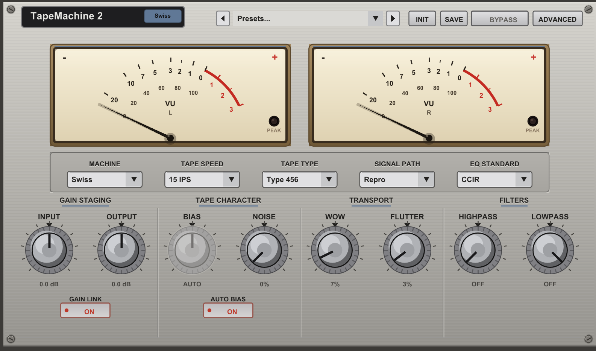

# TapeMachine 2

## Overview

TapeMachine 2 combines two tape-deck models in one stereo effect. **Swiss**
provides tracking and mix coloration, while **American** provides a mastering
deck topology with additional transport and electronics options. The machine,
speed, tape formulation, equalization, bias, and signal path all change the
modeled recording and playback chain.

The factory bank contains 20 calibrated presets. They are useful starting
points, but Input, Bias, transport modulation, filters, and the Advanced
reproduce EQ remain fully editable.

TapeMachine 2 has a distinct plugin ID from TapeMachine 1.x, so both can be
installed for old-session compatibility.

## Quick start

1. Insert TapeMachine 2 on a stereo track or bus.
2. Choose **Classic Rock Crisp** for restrained Swiss color or **Big 456
   Master** for American mastering color.
3. Leave **Gain Link** on and raise **Input**. The linked Output control moves in
   the opposite direction, so what you hear is the tape working harder and not
   just a louder signal.
4. Compare with the top-right **Bypass** button.
5. For stronger color, try **Thick Saturation**, **Drum Bus**, or **Fat 456
   Master**. For deliberate degradation, try **Sunbaked Cassette** or **Old
   Tape**.

## Machine and tape controls

### Machine

- **Swiss** is the tracking and mix model. It supports 7.5, 15,
  and 30 IPS.
- **American** is the mastering model. It adds 3.75 IPS, head
  width, crosstalk, a master wow/flutter switch, and transformer switching.

### Tape speed

- **3.75 IPS** is American only; it has narrow bandwidth and the strongest
  slow-speed character.
- **7.5 IPS** gives pronounced head and bandwidth character.
- **15 IPS** is the general-purpose reference speed.
- **30 IPS** gives tighter low-frequency behavior and extended bandwidth.

### Tape type

- **456**: classic general-purpose formulation.
- **GP9**: high-output formulation.
- **900**: clean modern formulation.
- **250**: older, more colored formulation.

### Signal path

- **Repro**: complete record/tape/reproduce path.
- **Sync**: playback through the sync-head geometry.
- **Input**: electronics and EQ without tape saturation, modulation, or noise.
- **Thru**: direct signal path for comparison.

### EQ and bias

- **EQ Standard** selects NAB or CCIR.
- **Auto Bias** derives bias from the current tape and speed. Turn it off to use
  the Bias knob manually.

## Main controls

### Gain staging

- **Input** ranges from -12 to +12 dB and is the primary drive control.
- **Output** ranges from -12 to +12 dB.
- **Gain Link** ties Output to Input: Output is always the exact opposite of
  Input (Input +6 dB gives Output -6 dB), and moving either knob moves the other.
  The gain you add going in is taken off coming out. The level change that
  remains is what the tape itself does: driven hard by a loud source, tape
  compresses and the result comes out lower, by several dB on the hottest
  presets; a few settings come out a little louder than they go in. Nothing
  measures or rides the level. Loading a preset sets its own Output value for
  use with the link off.

### Tape character

- **Bias** ranges from 0 to 100%. It is inactive while Auto Bias is on.
- **Noise** controls the modeled deck-specific hiss and hum. Zero disables it.

### Transport

- **Wow** controls slow pitch drift.
- **Flutter** controls faster pitch variation.
- American also has a **W&F** master switch that gates both controls.

### Filters

- **Highpass** ranges from 20 to 500 Hz; 20 Hz displays as Off.
- **Lowpass** ranges from 3 to 20 kHz; 20 kHz displays as Off.

The nonlinear core is fixed at its fitted 2× oversampling mode. There is no
user-facing oversampling selector in TapeMachine 2.

## Advanced panel

Click **Advanced** to open the reproduce-head controls:

- **Low**: 80 Hz shelf, ±12 dB
- **Lo-Mid**: 160 Hz peak, ±12 dB
- **Hi-Mid**: 5 kHz peak, ±12 dB
- **High**: 9 kHz shelf, ±12 dB

On American, the panel also exposes:

- **Crosstalk**: adjacent-track bleed modeling
- **XFMR**: output-transformer low-frequency and even-harmonic character

These controls are part of the factory-preset fits. Resetting them to zero can
substantially change a preset's match and saturation reading.

## Factory presets

### American mastering

- Big 456 Master
- Nice 456 Master
- Jazz Vision Master
- Clean 900 Master

### American color

- Fat 456 Master
- GP9 Drum Bus
- Bass Bump
- Bright & Sizzly

### Swiss mix

- Classic Rock Crisp
- Modern Rock
- Drum Bus
- Hi-Fi Shine
- Lush Film
- Jazz Warmth

### Swiss color

- Thick Saturation
- Hip-Hop Punch
- Vocal Presence

### Lo-fi

- Sunbaked Cassette: American at 3.75 IPS
- Analog Warmth: American at 3.75 IPS
- Old Tape: Swiss at 7.5 IPS

The preset menu is split into American and Swiss columns. **Init** restores
defaults. **Save** stores user presets in
`~/.config/DuskAudio/TapeMachine2/presets`.

## Practical workflows

### Transparent mix color

Start with **Classic Rock Crisp** or **Modern Rock**. Leave wow, flutter, and
noise at zero. Keep Gain Link on, then adjust Input: Output follows in the
opposite direction, so the level stays close while the color changes. Switch
to 30 IPS if you want less low-speed character.

### Drum-bus saturation

Start with **Drum Bus**, **GP9 Drum Bus**, or **Fat 456 Master**. Preserve the
factory Advanced EQ at first. Adjust Input for density. For a final makeup trim,
turn Gain Link off and use Output.

### Strong tape color

Start with **Thick Saturation**. Its Input and Hi-Mid reproduce settings were
jointly fitted: changing one affects both frequency response and measured THD.
Use small moves and level-match before deciding.

### Lo-fi treatment

Start with **Sunbaked Cassette** or **Old Tape**. Raise Wow, Flutter, or Noise for
more instability; lower the Lowpass for a narrower result. Sunbaked uses the
American-only 3.75 IPS mode.

## Troubleshooting

**Input gets louder but Output turns down.** Gain Link is on. This is intentional
level compensation. Turn it off for independent input and output gains.

**The level drops when I push Input with Gain Link on.** That is the tape
compressing. Gain Link removes the gain you added, not the compression. Turn the
link off and raise Output if you want to make it up.

**A preset change takes a moment to arrive.** Changing the machine, the speed or
the calibration, or (with Gain Link on) dropping Input by more than 6 dB at
once, is a short morph: for about 60 ms the old setting and the new one both
play, as on the tape machines this plugin is modelled on. There is no cut and no
burst; between two very different presets the level can dip a few dB while both
play. The morph starts one to three processing blocks after the change, so that
a whole preset arrives together; a change made while a morph is running waits
for that morph to end first. With Gain Link off, Input and Output are plain
level controls at any size of step: they act at once and are not morphed. A drop
of Input by more than 6 dB at once then restarts the tape path over a couple of
milliseconds, as before, and a second such drop within a tenth of a second
follows the knob smoothly instead. The same goes for a preset loaded while Gain
Link is off: if it lowers Input by more than 6 dB, the old setting is cut over a
couple of milliseconds. If the preset also changes the machine, the speed or
the calibration, or turns Gain Link on in the same moment as it lowers Input,
the morph to the new setting follows that cut.

**There is a tiny gap when I switch bypass off.** Coming back from bypass or
Thru starts the tape path from a clean state: the signal comes back in over a
couple of milliseconds. A preset loaded while on bypass or the Thru path comes
in the same way, with no morph.

**Bias does not respond.** Auto Bias is on. Disable it before adjusting Bias.

**Wow and Flutter do nothing on American.** Enable the W&F master switch.

**I cannot select 3.75 IPS on Swiss.** That speed is American-only.

**I cannot find oversampling.** TapeMachine 2 is permanently tuned at 2×. The
legacy parameter is hidden and retained only for session-state compatibility.

**The factory preset changed after zeroing Advanced EQ.** The four reproduce EQ
values are intentional parts of each fitted preset.

## Formats and requirements

- macOS 10.15 or newer: AU, VST3, CLAP, LV2; universal arm64/x86_64
- Linux (x86_64 and arm64): VST3, CLAP, LV2
- Windows (x86_64): VST3, CLAP
- A Standalone build is not currently shipped

macOS builds are not code-signed or notarized. On first launch Gatekeeper will
warn; either right-click the plugin and choose Open, or clear the quarantine flag
with `xattr -dr com.apple.quarantine <bundle>`.

Each release archive contains the plugin bundles, the GPL LICENSE, third-party
license notices, and the User Manual PDF. Every release also publishes a
SHA256SUMS file for integrity checking.
